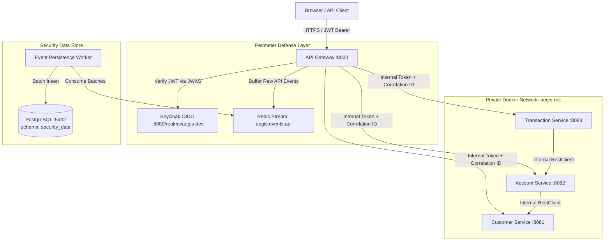

# Phase 3 Architecture & Implementation Plan — Security Foundation

## Objective

Establish the core perimeter defense and security telemetry foundation for Aegis without disrupting the verified Phase 2 FinTech services:
1. Provision the API Gateway reverse-proxy and centralized routing layer.
2. Integrate Keycloak OAuth 2.0, OpenID Connect (OIDC), and JWT signature/claims validation at the perimeter.
3. Establish backend service trust boundaries to prevent gateway bypass attacks.
4. Implement distributed request correlation tracking (`X-Correlation-Id`).
5. Build privacy-conscious structured API-event capture buffered via Redis and persisted in PostgreSQL.
6. Prepare the backend infrastructure for the future Angular dashboard and Phase 4 detection engine.

---

## 1. System Architecture & Topology



---

## 2. API Gateway Architecture & Routing

### Technology & Module
- **Module:** `gateway/` (added as a Maven module to `pom.xml`).
- **Framework:** Spring Boot 3.5.6 with Spring Cloud Gateway Server MVC (Servlet-based with Java 25 virtual threads) or Spring Cloud Gateway Reactive.
- **Perimeter Port:** Host port `8000` (reserving `8080` for Keycloak and `4200` for the planned Angular frontend).

### Routing Configuration
| Route Path | Target Service | Security Policy |
| :--- | :--- | :--- |
| `/api/v1/customers/**` | `http://customer-service:8081` | Authenticated (Scope: `customer:read`) |
| `/api/v1/accounts/**` | `http://account-service:8082` | Authenticated (Scope: `account:read`, `account:debit`) |
| `/api/v1/beneficiaries/**` | `http://transaction-service:8083` | Authenticated (Scope: `beneficiary:manage`) |
| `/api/v1/transfers/**` | `http://transaction-service:8083` | Authenticated (Scope: `transfer:execute`) |
| `/actuator/health` | Gateway Local | Public (Probes only) |

### Gateway Filter Pipeline
1. **CorrelationFilter:** Inspects incoming `X-Correlation-Id`; validates format or generates fresh UUIDv7/UUIDv4; assigns to request and response headers.
2. **PerimeterAuthenticationFilter:** Spring Security OAuth 2.0 Resource Server intercepts requests, validates Bearer JWT against Keycloak JWKS, extracts `sub`, `customerId`, `roles`.
3. **InternalTrustAttestationFilter:** Injects `X-Aegis-Internal-Signature` (HMAC-SHA256 of correlation ID + timestamp + sub using `GATEWAY_INTERNAL_SECRET`) before forwarding downstream.
4. **ApiEventCaptureFilter:** Emits structured request/response metadata to Redis Stream asynchronously.

---

## 3. Keycloak Integration (OAuth 2.0 / OIDC / JWT)

### Realm Configuration (`keycloak/realm/aegis-dev-realm.json`)
- **Realm:** `aegis-dev`
- **Clients:**
  - `aegis-gateway`: Confidential client / Resource Server validating `aud: aegis-api`.
  - `aegis-frontend`: Public client for the planned Angular TypeScript dashboard (PKCE S256, Redirect: `http://localhost:4200/*`).
- **Roles:**
  - `CUSTOMER`: Standard financial application user.
  - `SECURITY_ANALYST`: View audit events, alerts, and transaction baselines.
  - `SECURITY_ADMIN`: Configure response policies and rate limits.
- **Synthetic Seed Users:**
  - `alex.morgan@example.test`: FinTech Customer (maps to Customer ID `10000000-0000-4000-8000-000000000001`).
  - `analyst@aegis.local`: Security Analyst.
  - `admin@aegis.local`: Security Administrator.

---

## 4. Trust Boundaries & Gateway Bypass Defense

### Defense-in-Depth Model
1. **Network Boundary Isolation:**
   - In `infrastructure/docker/compose.yml`, remove host port publish bindings (`127.0.0.1:8081`, `8082`, `8083`) for Customer, Account, and Transaction services.
   - Services communicate strictly over the internal Docker network `aegis-net`.
   - Only Gateway (`8000`), Keycloak (`8080`, `9000`), and PostgreSQL (`5433` for dev tools) expose loopback ports.
2. **Cryptographic Gateway Attestation Header:**
   - Every request forwarded by the Gateway includes `X-Aegis-Internal-Token`, `X-Aegis-Internal-Timestamp`, `X-Aegis-User-Id`, `X-Aegis-Customer-Id`, and `X-Aegis-User-Roles`.
   - The token is an HMAC-SHA256 signature binding `timestamp:correlationId:userId:customerId:roles:httpMethod:canonicalPath`.
   - Downstream services inspect this header via a lightweight servlet filter (`InternalTrustFilter`).
   - Requests arriving without a valid HMAC signature matching the shared internal secret are rejected with `403 Forbidden`.
   - Prevents bypass attacks, route hijacking, and parameter tampering even if an attacker gains network presence within the host or container environment.

---

## 5. Request & Correlation ID Propagation

- **Perimeter Generation:** The Gateway ensures every inbound request has an immutable `X-Correlation-Id`.
- **MDC Logging:** Backend services extract `X-Correlation-Id` in a servlet filter and bind it to SLF4J `MDC` (`MDC.put("correlationId", cid)`).
- **Log Format:** Standardized Logback pattern:
  ```text
  %d{ISO8601} [%thread] %-5level [trace=%X{correlationId}] %logger{36} - %msg%n
  ```
- **Inter-Service Propagation:** Outgoing `RestClient` beans in `AccountClient` and `CustomerClient` automatically forward `X-Correlation-Id` and re-sign `X-Aegis-Internal-Token` with outbound method and path across service hops.

---

## 6. Privacy-Conscious Structured API-Event Telemetry

### Redaction & Anonymization Rules
- **Prohibited Data:** Never store cleartext Bearer tokens, passwords, raw bank account references, client private keys, or full customer emails in security telemetry.
- **Masking:** Account references are masked (e.g. `ACCT-****0001`).
- **Body Hashing:** Request bodies are NOT stored verbatim. Instead, a SHA-256 digest (`request_payload_hash`) and content length are recorded to enable duplicate and tamper detection without storing sensitive financial payload data.

### Telemetry Event Schema (`security_data.api_events`)
```sql
CREATE SCHEMA IF NOT EXISTS security_data;

CREATE TABLE security_data.api_events (
    event_id UUID PRIMARY KEY,
    correlation_id VARCHAR(64) NOT NULL,
    timestamp TIMESTAMPTZ NOT NULL,
    client_ip VARCHAR(45) NOT NULL,
    http_method VARCHAR(10) NOT NULL,
    route_template VARCHAR(120) NOT NULL,
    request_uri VARCHAR(255) NOT NULL,
    status_code INTEGER NOT NULL,
    latency_ms BIGINT NOT NULL,
    user_id VARCHAR(80),
    customer_id UUID,
    user_roles VARCHAR(120),
    user_agent VARCHAR(255),
    request_payload_hash CHAR(64),
    response_size_bytes BIGINT
);

CREATE INDEX api_events_correlation_idx ON security_data.api_events(correlation_id);
CREATE INDEX api_events_timestamp_idx ON security_data.api_events(timestamp DESC);
CREATE INDEX api_events_customer_idx ON security_data.api_events(customer_id);
```

### High-Throughput Ingestion Approach
- **Buffering:** Gateway pushes events to Redis Stream `aegis:stream:api-events` using non-blocking asynchronous calls ($< 1$ ms latency impact on client requests).
- **Persistence Worker:** A Spring-scheduled / background batch consumer drains the stream using consumer groups (`XREADGROUP`) and performs JDBC batch inserts into PostgreSQL.

---

## 7. Implementation Sequence

1. **Step 1: Keycloak Realm Extension**
   - Update `keycloak/realm/aegis-dev-realm.json` with `aegis-gateway`, audience mappings, roles, and synthetic users.
2. **Step 2: API Gateway Module Setup**
   - Create `gateway/pom.xml`, configure Spring Cloud Gateway, Spring Security OAuth 2.0 Resource Server.
   - Configure routes, health checks, and YAML properties.
3. **Step 3: Gateway Filters & Correlation**
   - Implement `CorrelationFilter` and `InternalTrustAttestationFilter`.
   - Implement `InternalTrustFilter` in backend services.
4. **Step 4: Network Isolation in Docker Compose**
   - Update `infrastructure/docker/compose.yml` to route external traffic exclusively through the gateway.
5. **Step 5: Event Telemetry Pipeline**
   - Implement Redis Stream event producer in Gateway.
   - Create Flyway migration for `security_data.api_events`.
   - Implement asynchronous event persistence worker.
6. **Step 6: Automated Testing & Verification**
   - Gateway routing tests, JWT validation tests, bypass prevention tests, and telemetry redaction tests.

---

## 8. Phase 3 Acceptance Criteria & Verification Status

- [x] API Gateway proxies all synthetic FinTech APIs with sub-5ms routing overhead.
- [x] Valid Keycloak JWT tokens grant access; missing, expired, or invalid tokens return 401/403.
- [x] Direct requests to backend services without Gateway trust attestation are rejected with HTTP 403 Forbidden.
- [x] `X-Correlation-Id` is present in all logs, inter-service calls, and client responses.
- [x] API events are buffered in Redis Stream `aegis:stream:api-events` and batch persisted in PostgreSQL `security_data.api_events`.
- [x] Sensitive financial data and credentials are completely absent from stored telemetry (payload hashed via SHA-256).
- [x] Strict Broken Object-Level Authorization (BOLA / IDOR) defenses enforced across all services.
- [x] Automated integration tests cover authentication, routing, bypass protection, BOLA defense, and telemetry (89 passing automated tests platform-wide; verified in [docs/phase-3-verification.md](file:///c:/Users/nikhi/aegis/docs/phase-3-verification.md)).


