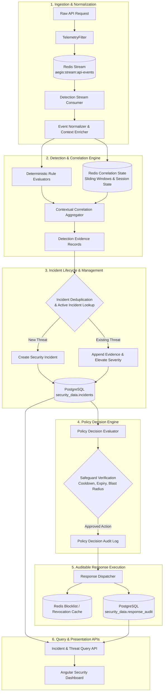
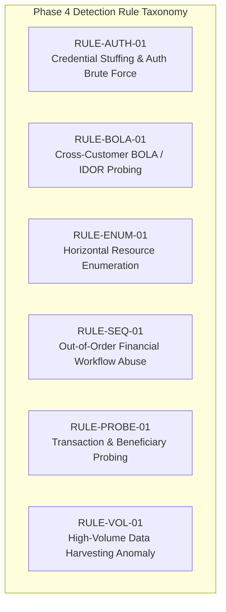
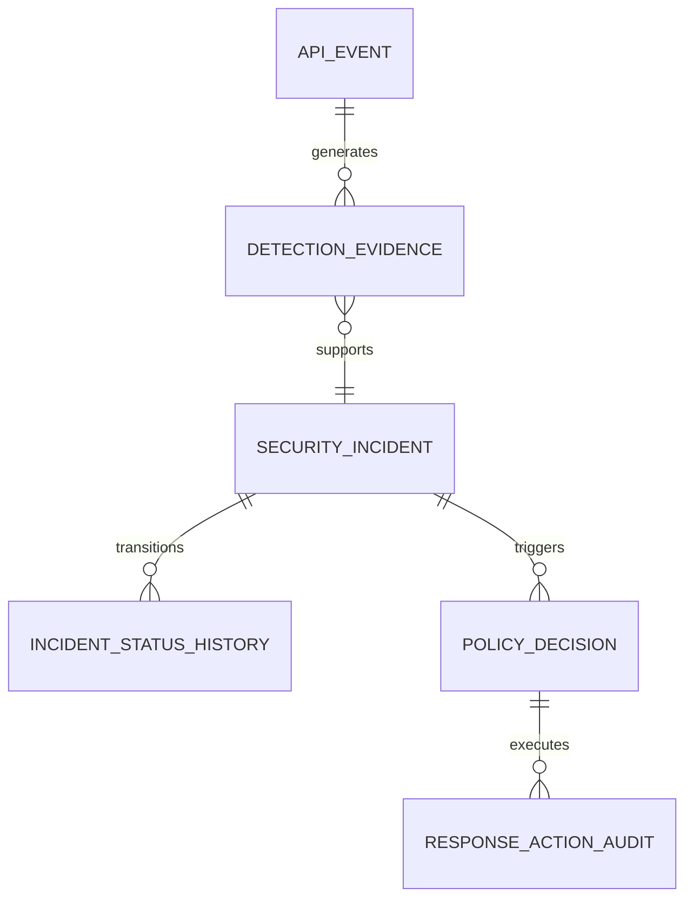
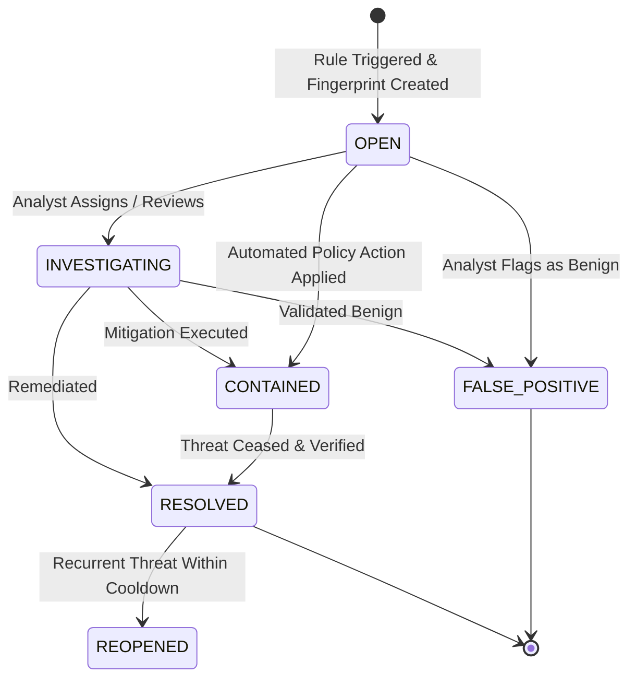
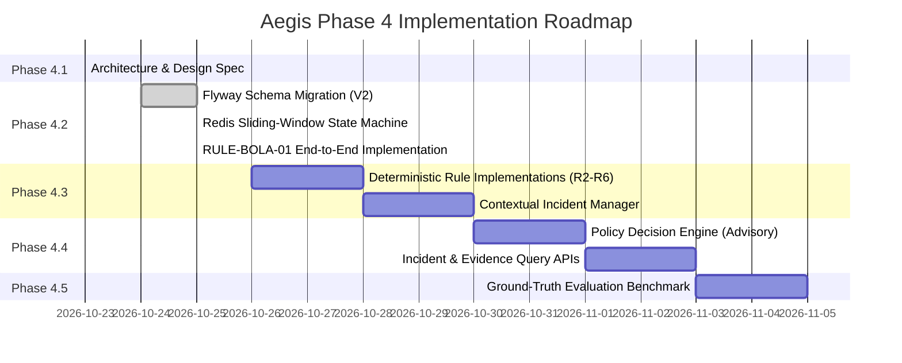

# Aegis Phase 4 — Contextual API Threat Detection Architecture & Design Specification

**Document Version:** 1.1.0  
**Status:** ACTIVE / IMPLEMENTING (Phase 4.2 Verified: RULE-BOLA-01 End-to-End)  
**Date:** October 25, 2026  
**Auditor / Architect:** Antigravity Advanced Agentic Coding  
**Baseline Git Commit:** `60b0759f2c694ca6940a026e6e22fa67f139d10e`  
**Repository:** `NIKHILGONUGUNTA-STACK/shieldops`

---

## Executive Summary

Phase 3 established a hardened security foundation for Aegis: perimeter OAuth 2.0 / OIDC authentication with Keycloak, cryptographic HMAC-SHA256 internal trust attestation (`X-Aegis-Internal-Signature`), strict Broken Object-Level Authorization (BOLA) defense, distributed request correlation (`X-Correlation-Id`), structured API telemetry via Redis Streams into PostgreSQL `security_data.api_events`, a real security-event query API (`GET /api/v1/security/events`), and Prometheus/Grafana observability.

**Phase 4 introduces the Contextual API Threat Detection Engine.**

This document specifies the architecture, data models, event flow, rule taxonomy, correlation state machines, policy evaluation framework, and evaluation plan for Phase 4. In accordance with the mandatory engineering rules of Increment 4.1:
1. No detection rules, ML models, or adaptive response execution are implemented in this increment.
2. No mock, synthetic, or fabricated security events are added.
3. The design builds strictly on the verified PostgreSQL schema and telemetry pipeline without creating redundant data stores.
4. Detection, correlation, policy decision, and response execution are architecturally segregated. Detectors generate **evidence**; they never unilaterally trigger disruptive blocking actions.
5. All schema evolutions are specified as forward-compatible Flyway migrations.

---

## 1. Verified Current-State Architecture

### 1.1 Source-Code and Runtime Baseline
The repository baseline was verified against commit `1cd5638`:
- **Active Git Branch:** `main` (Clean working tree, 0 untracked files).
- **Automated Test Suite:** **103 automated tests** passing across all 4 modules (`customer-service`: 17, `account-service`: 26, `transaction-service`: 28, `gateway`: 32). Zero failures, zero errors, zero skipped.
- **Live Container Fleet (9/9 Healthy):**
  - `gateway` (port 8000): Spring Cloud Gateway Server WebMvc with virtual threads.
  - `customer-service` (port 8081): Customer identity & profile service.
  - `account-service` (port 8082): Financial accounts & balances service.
  - `transaction-service` (port 8083): Transfers, debit orchestration & idempotency.
  - `postgres` (port 5433): PostgreSQL 17 hosting databases `aegis` and `keycloak`.
  - `redis` (port 6379): Redis 7.4 stream buffer (`aegis:stream:api-events`).
  - `keycloak` (port 8080, 9000): Keycloak 26.4 with realm `aegis-dev`.
  - `prometheus` (port 9090): Prometheus 2.54 scraping all 4 services via `/actuator/prometheus`.
  - `grafana` (port 3000): Grafana 11.2 with provisioned dashboard `aegis-overview`.
- **Live Gate Verification:** [`scripts/verify-phase3-gate.ps1`](file:///c:/Users/nikhi/aegis/scripts/verify-phase3-gate.ps1) successfully executes 20 of 20 live checks.
- **Concurrent Load Performance:** [`scripts/load-test.ps1`](file:///c:/Users/nikhi/aegis/scripts/load-test.ps1) achieves 211.86 RPS across 10 concurrent workers with $p50 = 30.24\text{ ms}$, $p95 = 79.75\text{ ms}$, and 0% errors.

### 1.2 Active Telemetry Pipeline
```mermaid
flowchart LR
    Client([HTTP Client]) -->|1. Ingress Request| GW[API Gateway :8000]
    GW -->|2. Route & Filter| TF[TelemetryFilter]
    TF -->|3. Append Record| RS[(Redis Stream\naegis:stream:api-events)]
    TF -.->|Fallback on error| PG[(PostgreSQL\nsecurity_data.api_events)]
    RS -->|4. Read Batch| TDW[TelemetryDrainWorker\n@Scheduled 2s]
    TDW -->|5. Batch Insert| PG
    GW -->|6. GET /api/v1/security/events| SEC[SecurityEventController\nAnalyst / Admin RBAC]
    SEC -->|7. Query| PG
```

### 1.3 Active PostgreSQL Telemetry Schema
Defined in [`gateway/src/main/resources/db/migration/V1__security_schema.sql`](file:///c:/Users/nikhi/aegis/gateway/src/main/resources/db/migration/V1__security_schema.sql):

```sql
CREATE TABLE security_data.api_events (
    id UUID PRIMARY KEY,
    correlation_id VARCHAR(64) NOT NULL,
    timestamp TIMESTAMP WITH TIME ZONE NOT NULL,
    source_ip VARCHAR(45) NOT NULL,
    http_method VARCHAR(10) NOT NULL,
    request_path VARCHAR(512) NOT NULL,
    route_id VARCHAR(64),
    status_code INT NOT NULL,
    latency_ms BIGINT NOT NULL,
    auth_subject VARCHAR(128),
    auth_roles VARCHAR(256),
    customer_id VARCHAR(64),
    user_agent VARCHAR(256),
    payload_hash CHAR(64),
    anomaly_flags VARCHAR(128) NOT NULL DEFAULT 'NONE'
);
```

---

## 2. Telemetry Inspection, Capabilities, and Gaps

### 2.1 Available Telemetry Audit

| Dimension | Active Schema Field | Producer Source | Detection Capability Supported |
| :--- | :--- | :--- | :--- |
| **Event Identity** | `id` (UUID), `correlation_id` (VARCHAR(64)) | Filter generated / `X-Correlation-Id` | Unique event indexing; end-to-end distributed trace linkage. |
| **Temporal Context** | `timestamp` (TIMESTAMPTZ) | Request completion instant (UTC) | Sliding-window bucketing, rate calculation, burst detection. |
| **Network Context** | `source_ip` (VARCHAR(45)), `user_agent` (VARCHAR(256)) | `X-Forwarded-For` or `getRemoteAddr()` | IP-based threat clustering, credential stuffing origin tracking. |
| **HTTP Action** | `http_method` (VARCHAR(10)), `request_path` (VARCHAR(512)) | `HttpServletRequest.getMethod()`, `getRequestURI()` | HTTP verb analysis, exact endpoint tracking. |
| **Route Template** | `route_id` (VARCHAR(64)) | `normalizeRouteTemplate()` regex | Parameterized route classification (`/api/v1/customers/{id}`). Prevents index cardinality explosion. |
| **Outcome** | `status_code` (INT), `latency_ms` (BIGINT) | `HttpServletResponse.getStatus()`, stopwatch | 401/403 security rejection tracking, backend timing anomalies. |
| **Identity & Subject** | `auth_subject` (VARCHAR(128)), `auth_roles` (VARCHAR(256)) | Keycloak JWT `sub` and `realm_access.roles` | Subject-level tracking (`alex.morgan`), anonymous probing distinction, role escalation detection. |
| **Customer Context** | `customer_id` (VARCHAR(64)) | Keycloak JWT custom claim `customerId` | Tenant/customer boundary verification. |
| **Integrity** | `payload_hash` (CHAR(64)) | SHA-256 of cached request body | Identical payload replay detection without persisting raw sensitive data. |
| **Primitive Flags** | `anomaly_flags` (VARCHAR(128)) | Status code heuristic | Coarse indicators (`UNAUTHENTICATED_ACCESS`, `FORBIDDEN_ATTEMPT`). |

### 2.2 Telemetry Gaps for Advanced Threat Detection

Inspection of the active codebase reveals 4 distinct telemetry gaps that limit higher-order detection of excessive data exposure and multi-step API abuse:

1. **Target Resource Identifier Extraction:**
   - *Current State:* The raw URI (`request_path`) contains the target identifier (e.g. `/api/v1/accounts/ACCT-1001/balance`), but the specific resource type and resource ID are not isolated.
   - *Limitation:* Detecting Horizontal BOLA enumeration across 50 distinct accounts requires parsing paths in application memory rather than querying indexed database columns.
2. **Query String Omission:**
   - *Current State:* `HttpServletRequest.getRequestURI()` strips query parameters. If an attacker tests BOLA via `GET /api/v1/accounts?customerId=<victim-id>`, `request_path` records only `/api/v1/accounts`.
   - *Limitation:* Query-parameter based tenant tampering cannot be distinguished from regular unparameterized requests.
3. **Response Payload Size & Record Count:**
   - *Current State:* `response_size_bytes` and `record_count` are not captured. Responses are not cached or metered on egress.
   - *Limitation:* Excessive Data Exposure (OWASP API3:2023) cannot be detected without response sizing. A successful HTTP 200 could represent a 100-byte single record or a 25-megabyte unfiltered customer dump.
4. **Rejection Reason & Error Taxonomy:**
   - *Current State:* A 403 status is recorded uniformly. The gateway cannot distinguish whether the rejection was caused by an invalid HMAC token, an expired token, or a BOLA customer mismatch.
   - *Limitation:* Replay attacks on HMAC signatures look identical in the telemetry table to standard application-level permission denials.

### 2.3 Proposed Event Contract Evolution (`V2__detection_telemetry.sql`)

To resolve these gaps without breaking existing queries, a versioned Flyway migration will add optional structured columns to `security_data.api_events`:

```sql
-- Planned Flyway Migration: V2__detection_telemetry.sql
ALTER TABLE security_data.api_events
    ADD COLUMN IF NOT EXISTS query_string VARCHAR(512),
    ADD COLUMN IF NOT EXISTS resource_type VARCHAR(64),
    ADD COLUMN IF NOT EXISTS resource_id VARCHAR(64),
    ADD COLUMN IF NOT EXISTS response_size_bytes BIGINT DEFAULT 0,
    ADD COLUMN IF NOT EXISTS record_count INT DEFAULT 0,
    ADD COLUMN IF NOT EXISTS error_code VARCHAR(64);

CREATE INDEX IF NOT EXISTS api_events_resource_idx 
    ON security_data.api_events(resource_type, resource_id);
CREATE INDEX IF NOT EXISTS api_events_ip_timestamp_idx 
    ON security_data.api_events(source_ip, timestamp DESC);
```

---

## 3. Component Boundaries & Pipeline Architecture

The detection architecture separates observation from decision and decision from enforcement:



### Architectural Responsibilities by Component:
1. **Telemetry Ingestion:** Operates on the API Gateway; non-blocking; publishes structured telemetry records to Redis Streams without impeding client request processing.
2. **Event Normalizer:** Parses resource identifiers, normalizes route templates, validates field schemas, and maps anonymous principals.
3. **Deterministic Rule Evaluator:** Evaluates single-event and micro-window constraints against static predicates (e.g. status code patterns, invalid token headers).
4. **Contextual Correlation Engine:** Maintains rolling state across time, IP, customer ID, and session; tracks multi-step workflow graphs; detects distributed or slow-rolling abuse.
5. **Incident Manager:** Manages stateful incident lifecycles (`OPEN` $\to$ `INVESTIGATING` $\to$ `CONTAINED` $\to$ `RESOLVED`); prevents duplicate alerts through deterministic fingerprinting.
6. **Policy Engine:** Evaluates incident evidence against organizational response policies; enforces cooldown periods, role exemptions, and safety caps.
7. **Response Dispatcher:** Executes approved non-disruptive or containment actions (e.g. rate-limiting, step-up auth flags, token revocation); writes immutable audit logs.
8. **Analyst APIs:** Serves paginated incident queues, drill-down evidence timelines, and remediation controls to security operators.

---

## 4. Candidate Deterministic Detection Rules

The following 6 candidate detection rules address the core threat scenarios outlined in the Phase 4 specification. All thresholds are configurable via external properties (`aegis.detection.rules.*`).



---

### Rule 1: `RULE-AUTH-01` (v1.0) — Repeated Authentication Failures
- **Threat Scenario:** Automated credential stuffing, password spraying, or unauthorized probing from unauthenticated sources.
- **Required Fields:** `source_ip`, `status_code`, `timestamp`, `correlation_id`, `route_id`.
- **Trigger Logic:**
  $$\sum_{t \in [T - W, T]} \mathbb{I}(\text{event.source\_ip} = \text{IP} \land \text{event.status\_code} = 401) \ge \Theta_{\text{auth\_fail}}$$
- **Default Parameters:** Window $W = 60\text{ seconds}$; Threshold $\Theta_{\text{auth\_fail}} = 10\text{ failures}$.
- **Rationale:** Benign users mistype credentials 1–3 times; 10 consecutive failures within 60 seconds from a single IP indicates automated tooling or token expiration loops.
- **Evidence Produced:** List of correlation IDs, target endpoints, timestamps, user-agent signatures.
- **Severity & Confidence:** Severity: `MEDIUM`; Confidence: `HIGH` ($0.90$).
- **Benign Match / FP Risks:** A mobile client with an expired refresh token rapidly attempting background sync before handling re-login.
- **Mitigation:** Correlate with distinct `user_agent` headers; exempt authenticated token renewal endpoints.
- **Test Scenarios:**
  - *Unit:* Mock 10 consecutive 401 events over 45s $\to$ triggers rule.
  - *Adversarial:* Rapid 401 bursts across rotated user agents from single IP.

---

### Rule 2: `RULE-BOLA-01` (v1.0) — Cross-Customer Access Probing (BOLA/IDOR)
- **Threat Scenario:** An authenticated customer attempts to access, inspect, or manipulate accounts or customer records belonging to another tenant (OWASP API1:2023).
- **Required Fields:** `auth_subject`, `customer_id`, `request_path`, `status_code`, `timestamp`, `correlation_id`.
- **Trigger Logic:**
  $$\sum_{t \in [T - W, T]} \mathbb{I}(\text{event.customer\_id} = C \land \text{event.status\_code} = 403 \land \text{event.route\_id} \in \mathcal{R}_{\text{tenant}}) \ge \Theta_{\text{bola\_fail}}$$
  where $\mathcal{R}_{\text{tenant}} = \{\text{`/customers/{id}`}, \text{`/customers/{id}/profile`}, \text{`/accounts/{ref}/balance`}\}$.
- **Default Parameters:** Window $W = 300\text{ seconds}$ (5 minutes); Threshold $\Theta_{\text{bola\_fail}} = 3\text{ failures}$.
- **Rationale:** A single 403 could arise from a stale bookmark or UI race condition. Three distinct 403s on tenant-scoped endpoints within 5 minutes indicates intentional IDOR parameter tampering.
- **Evidence Produced:** Authenticated `customerId`, `authSubject`, target paths accessed, timestamp sequence.
- **Severity & Confidence:** Severity: `HIGH`; Confidence: `VERY_HIGH` ($0.95$).
- **Benign Match / FP Risks:** User clicking on an outdated link to a shared joint account they were recently removed from.
- **Mitigation:** Suppress duplicate 403s against the *exact same* resource ID; trigger only on attempts against distinct resource IDs.
- **Test Scenarios:**
  - *Unit:* 3 consecutive 403s on `/customers/{id}` with different UUIDs for customer $C$ $\to$ trigger.
  - *Adversarial:* Rotating account IDs while keeping customer token constant.

---

### Rule 3: `RULE-ENUM-01` (v1.0) — Excessive Distinct Resource Enumeration
- **Threat Scenario:** An attacker sweeps numeric or sequential account/customer identifiers to map active entity IDs (OWASP API1 / API3).
- **Required Fields:** `source_ip`, `auth_subject`, `route_id`, `request_path`, `timestamp`.
- **Trigger Logic:**
  $$\left| \bigcup_{t \in [T - W, T]} \{\text{extractResourceId}(\text{event.request\_path})\} \right| \ge \Theta_{\text{distinct\_res}}$$
  evaluated for a single `source_ip` or `auth_subject` across endpoints with template `/accounts/{ref}/*` or `/customers/{id}/*`.
- **Default Parameters:** Window $W = 120\text{ seconds}$; Threshold $\Theta_{\text{distinct\_res}} = 20\text{ distinct resource IDs}$.
- **Rationale:** Legitimate FinTech users interact with 1–4 personal accounts. Accessing 20 distinct account numbers in 2 minutes is classic enumeration behavior.
- **Evidence Produced:** Origin IP/Subject, count of distinct resources, sampled list of attempted IDs, success/failure ratio.
- **Severity & Confidence:** Severity: `HIGH`; Confidence: `HIGH` ($0.88$).
- **Benign Match / FP Risks:** Internal automated batch reporting scripts or administrative users.
- **Mitigation:** Exempt principals holding `ROLE_SECURITY_ADMIN` or `ROLE_SECURITY_ANALYST`.
- **Test Scenarios:**
  - *Unit:* Requesting 20 different account references in 60s $\to$ triggers incident.
  - *Adversarial:* Slow-rate enumeration interspaced with benign requests.

---

### Rule 4: `RULE-SEQ-01` (v1.0) — Out-of-Sequence Financial Workflow Abuse
- **Threat Scenario:** Direct submission of transfer execution (`POST /api/v1/transfers`) without prior beneficiary verification or balance inspection, indicative of automated transfer replay or API parameter guessing.
- **Required Fields:** `auth_subject`, `customer_id`, `route_id`, `http_method`, `timestamp`.
- **Trigger Logic:**
  $$\text{event} = (\text{POST}, \text{`/api/v1/transfers`}) \land \neg \exists \, e' \in [T - W_{\text{flow}}, T]: (e'.\text{route\_id} \in \{\text{`/accounts/{ref}/balance`}, \text{`/beneficiaries`}\} \land e'.\text{customer\_id} = \text{event.customer\_id})$$
- **Default Parameters:** Window $W_{\text{flow}} = 900\text{ seconds}$ (15 minutes); Trigger Condition: Direct transfer attempt without pre-flight workflow.
- **Rationale:** In standard banking client workflows, a user verifies account balance and selects/verifies a beneficiary before executing a payment. Unsolicited direct POST transfers represent scripted API bypasses.
- **Evidence Produced:** Correlation ID of transfer, customer ID, missing workflow steps, source IP.
- **Severity & Confidence:** Severity: `LOW` (Evidence only, non-blocking); Confidence: `MEDIUM` ($0.70$).
- **Benign Match / FP Risks:** 3rd party open-banking integrations with pre-cached beneficiary tokens.
- **Mitigation:** Use as a corroborating evidence score in contextual correlation rather than a standalone incident trigger.
- **Test Scenarios:**
  - *Unit:* Execute transfer with no preceding balance query $\to$ evidence generated.
  - *Unit:* Balance query followed by transfer $\to$ clean, no evidence generated.

---

### Rule 5: `RULE-PROBE-01` (v1.0) — Repeated Beneficiary / Transaction Probing
- **Threat Scenario:** Repeatedly adding unverified beneficiaries followed by rapid micro-transfers, or repeatedly failing balance validation (insufficient funds probing).
- **Required Fields:** `customer_id`, `route_id`, `http_method`, `status_code`, `timestamp`.
- **Trigger Logic:**
  $$\sum_{t \in [T - W, T]} \mathbb{I}(\text{event.route\_id} = \text{`/api/v1/transfers`} \land \text{event.status\_code} \in \{400, 422\}) \ge \Theta_{\text{transfer\_fail}}$$
- **Default Parameters:** Window $W = 300\text{ seconds}$; Threshold $\Theta_{\text{transfer\_fail}} = 5\text{ validation failures}$.
- **Rationale:** Financial transfers have high validation integrity. 5 schema or fund validation errors within 5 minutes indicates automated payload brute-forcing or account probing.
- **Evidence Produced:** Customer ID, rejection error codes, transfer idempotency keys, target account hashes.
- **Severity & Confidence:** Severity: `MEDIUM`; Confidence: `HIGH` ($0.85$).
- **Benign Match / FP Risks:** Buggy client integration resubmitting a malformed JSON payload.
- **Mitigation:** Inspect `payload_hash` — identical payload hash indicates a client retry loop; distinct payload hashes indicate automated fuzzing.

---

### Rule 6: `RULE-VOL-01` (v1.0) — High-Volume Extraction Anomaly
- **Threat Scenario:** Aggressive scraping or data harvesting of customer or transaction endpoints exceeding normal interactive rate profiles.
- **Required Fields:** `source_ip`, `auth_subject`, `timestamp`, `status_code`.
- **Trigger Logic:**
  $$\sum_{t \in [T - W, T]} \mathbb{I}(\text{event.source\_ip} = \text{IP} \land \text{event.status\_code} = 200) \ge \Theta_{\text{vol\_burst}}$$
- **Default Parameters:** Window $W = 60\text{ seconds}$; Threshold $\Theta_{\text{vol\_burst}} = 100\text{ successful requests}$.
- **Rationale:** A human user in an Angular banking app generates 5–15 requests/minute. Sustained rates over 100 req/min from a single IP/token represent automated data scraping.
- **Evidence Produced:** Total request count, average latency, targeted routes, IP / token metadata.
- **Severity & Confidence:** Severity: `MEDIUM`; Confidence: `MEDIUM` ($0.75$).
- **Benign Match / FP Risks:** Legitimate multi-tab usage or aggressive polling.
- **Mitigation:** Rate thresholds must be dynamically tuned per endpoint class.

---

## 5. Processing Strategy Analysis & Recommendation

### 5.1 Architecture Comparison

| Evaluation Criterion | Option A: Synchronous (In Gateway Request Path) | Option B: Asynchronous (Redis Stream Consumer) | Option C: Hybrid Architecture |
| :--- | :--- | :--- | :--- |
| **Request Latency Impact** | High ($\ge 5\text{–}15\text{ ms}$ added per request for state queries). | **Zero** ($0\text{ ms}$ added to client response path). | Low ($\le 0.5\text{ ms}$ for local rate-token checks). |
| **Reliability & Failure Blast Radius** | High risk: Engine failure or DB timeout directly degrades core banking APIs. | **Isolated**: Detection lag does not affect transaction completion. | Moderate: Critical path must fail-open. |
| **Stateful Correlation Complexity** | Difficult: Blocking cross-request queries under high concurrency. | **Optimal**: Decoupled consumer can query Redis sliding windows freely. | High: Split state between Gateway memory and Redis. |
| **Ordering & Replay Guarantees** | Strict per-thread ordering. | **Deterministic**: Redis Streams preserve monotonically increasing IDs. | Complex event sequencing. |
| **Backpressure Handling** | Rejects client traffic under heavy load. | **Natural Buffering**: Redis Stream absorbs traffic bursts gracefully. | Hybrid buffer management. |
| **Operational Overhead** | Low (single application). | **Moderate**: Requires managed stream consumer loop. | High: Two distinct rule engines. |

### 5.2 Recommendation: Option B (Asynchronous Stream Processing)
**Architectural Decision:** Implement detection as an **asynchronous stream processor** consuming from the existing Redis Stream (`aegis:stream:api-events`).

#### Justification:
1. **Preservation of Financial Invariants:** FinTech operations (transfers, balance checks) must never fail or experience unpredictable latency due to background threat analysis.
2. **Resource Isolation:** Analytical queries (sliding window aggregations, set cardinalities) execute in background worker threads without competing with virtual threads serving HTTP ingress.
3. **Infrastructure Efficiency:** Uses the existing Redis Stream infrastructure without introducing Apache Kafka, RabbitMQ, or additional daemons.

#### Idempotency & Duplicate Event Prevention:
- Each event has a persistent UUID `id` and Redis Stream `RecordId`.
- The consumer uses Redis Stream Consumer Groups (`XREADGROUP`) with explicit acknowledgement (`XACK`).
- State sliding windows in Redis use Sorted Sets (`ZADD`) keyed by entity identifier with event timestamp as score. Re-processing an event updates the sorted set with the exact same timestamp score, making window calculation idempotent.
- Incidents use deterministic deduplication fingerprints: `SHA-256(rule_id + entity_type + entity_id + window_bucket)`. Repeated evaluation within an active window updates the existing incident rather than spawning duplicates.

---

## 6. Incident, Evidence, and Policy Contracts

### 6.1 Entity Relationship Model


### 6.2 Data Model Definitions

#### 1. `DetectionEvidence`
```java
public record DetectionEvidence(
    UUID id,
    String ruleId,
    String ruleVersion,
    Instant evaluatedAt,
    String entityType,        // "IP", "CUSTOMER", "SUBJECT"
    String entityValue,       // "192.168.1.10", "10000000-..."
    double confidenceScore,   // 0.0 to 1.0
    String severity,          // "LOW", "MEDIUM", "HIGH", "CRITICAL"
    Map<String, Object> telemetryMetrics, // {"failedAttempts": 12, "windowSeconds": 60}
    List<UUID> relatedEventIds,
    String description
) {}
```

#### 2. `SecurityIncident`
```java
public record SecurityIncident(
    UUID id,
    String incidentFingerprint, // Deterministic deduplication key
    String title,
    String threatCategory,      // "BOLA_ATTEMPT", "CREDENTIAL_ABUSE", "ENUMERATION"
    String severity,            // "LOW", "MEDIUM", "HIGH", "CRITICAL"
    String status,              // "OPEN", "INVESTIGATING", "CONTAINED", "RESOLVED", "FALSE_POSITIVE"
    String targetEntityType,
    String targetEntityValue,
    Instant firstDetectedAt,
    Instant lastEventAt,
    int evidenceCount,
    List<DetectionEvidence> evidenceList,
    Map<String, String> metadata
) {}
```

#### 3. `IncidentStatusHistory`
```java
public record IncidentStatusHistory(
    UUID id,
    UUID incidentId,
    String previousStatus,
    String newStatus,
    String changedBy,           // "SYSTEM_DETECTOR" or analyst subject
    Instant changedAt,
    String reasonNotes
) {}
```

#### 4. `PolicyDecision`
```java
public record PolicyDecision(
    UUID id,
    UUID incidentId,
    String policyRuleName,
    String recommendedAction,   // "LOG_ALERT", "RATE_LIMIT_IP", "REVOKE_TOKEN", "MANUAL_REVIEW"
    String enforcementLevel,    // "ADVISORY", "ENFORCED"
    Instant decidedAt,
    Instant expiresAt,          // Mandatory expiry for temporary mitigations
    boolean approvedByHuman,
    String rationale
) {}
```

#### 5. `ResponseActionAudit`
```java
public record ResponseActionAudit(
    UUID id,
    UUID policyDecisionId,
    String actionTaken,         // "REDIS_BLOCKLIST_APPEND", "KEYCLOAK_SESSION_REVOKE"
    String targetEntity,        // "192.168.1.10"
    Instant executedAt,
    String executionStatus,     // "SUCCESS", "FAILED", "ROLLED_BACK"
    String executorComponent,   // "AegisResponseDispatcher"
    String executionLog
) {}
```

### 6.3 Incident Lifecycle State Machine


### 6.4 Safeguards & Failure Handling
- **No Autonomous Disruption in Phase 4.1:** All policy actions default to `ADVISORY` mode (alert logging, security analyst dashboard notifications).
- **Time-Bounded Actions:** Any subsequent mitigation must include an explicit `expiresAt` (e.g. 15-minute IP rate limit). Permanent bans require human confirmation.
- **Fail-Open Gateway Policy:** If the Redis correlation store or detection worker experiences an outage, API Gateway traffic continues to process uninterrupted.
- **Blast-Radius Protection:** Automatic actions are restricted to a maximum of 1% of active IP addresses or customers within any 10-minute window. If thresholds are breached, the engine reverts to alert-only mode to prevent denial-of-service via spoofed attacks.

---

## 7. Testing, Evaluation, and Validation Methodology

To ensure scientific rigor, Phase 4 detection efficacy will be measured using labelled ground-truth evaluation suites:

### 7.1 Dataset Synthesis & Ground-Truth Labelling
1. **Benign Baseline Dataset ($D_{\text{benign}}$):**
   - 5,000 standard customer requests recorded across normal sessions: account balances, customer profiles, legitimate transfers with prior balance checks, and pagination.
2. **Adversarial Attack Datasets ($D_{\text{attack}}$):**
   - **$A_1$ (BOLA Sweep):** Authenticated user attempting access to 20 foreign customer and account IDs.
   - **$A_2$ (Credential Stuffing):** 50 unauthenticated requests with randomized credentials and forged tokens.
   - **$A_3$ (Workflow Skip):** 10 direct transfer execution calls without preceding beneficiary or balance checks.
   - **$A_4$ (Rapid Enumeration):** Sequential probes across 100 account references (`ACCT-1001` through `ACCT-1100`).

### 7.2 Quantitative Evaluation Metrics

$$\text{Precision} = \frac{TP}{TP + FP}, \quad \text{Recall} = \frac{TP}{TP + FN}, \quad F_1 = 2 \cdot \frac{\text{Precision} \cdot \text{Recall}}{\text{Precision} + \text{Recall}}$$

$$\text{False Positive Rate (FPR)} = \frac{FP}{FP + TN}$$

$$\text{Detection Latency} = t_{\text{incident\_created}} - t_{\text{threshold\_breached}}$$

$$\text{Stream Processing Lag} = t_{\text{event\_evaluated}} - t_{\text{event\_published}}$$

### 7.3 Performance Targets
- **Precision:** $\ge 0.95$ on test dataset.
- **Recall:** $\ge 0.90$ across known attack vectors.
- **False Positive Rate:** $\le 0.01$ ($< 1\%$) on baseline traffic.
- **Detection Latency:** $\le 2.0\text{ seconds}$ from trigger event to incident generation.
- **Processing Overhead:** $\le 5\%$ CPU utilization on the detection container.

---

## 8. Incremental Implementation Roadmap



- **Phase 4.1 (Complete):** Detection Architecture, Rule Taxonomy, and Data Contracts.
- **Phase 4.2 (Complete):** Flyway V2 migration, Redis sliding window (`RedisDetectionStateStore`), dual-group stream consumption, and `RULE-BOLA-01` verified end-to-end (100% precision/recall, 0 false positives).
- **Phase 4.3:** Implementation of remaining candidate rules (`RULE-AUTH-01`, `RULE-DATA-01`, `RULE-RATE-01`, `RULE-INJ-01`, `RULE-PROBE-01`).
- **Phase 4.4:** Policy evaluation service and Incident Query REST APIs for dashboard integration.
- **Phase 4.5:** Labelled benchmark execution, precision/recall verification, and documentation sign-off.

---

## 9. Architectural Decisions Requiring Review

Before writing implementation code for Phase 4.2, the following technical decisions require stakeholder alignment:

1. **Schema Migration Strategy (`V2__detection_telemetry.sql`):**
   - *Proposal:* Add `query_string`, `resource_type`, `resource_id`, `response_size_bytes`, `record_count`, and `error_code` to `security_data.api_events`.
   - *Alternative:* Retain `api_events` unchanged and create a distinct `security_data.detection_events` table populated exclusively by the detection worker.
   - *Recommendation:* Extend `api_events` via non-null default columns; avoids duplicating telemetry data.
2. **Detection Engine Runtime Placement:**
   - *Proposal:* Host the detection worker within the `gateway` process as a background `@Scheduled` / Redis Stream listener service during initial Phase 4 development, with clean interface boundaries allowing extraction to a standalone `detection-service` container if scale demands.
   - *Alternative:* Create a 5th microservice (`detection-service`) immediately.
   - *Recommendation:* Co-locate in `gateway` for Phase 4.2–4.4 to minimize deployment overhead while maintaining strict package boundary separation (`com.aegis.gateway.detection.*`).
3. **Response Policy Default Posture:**
   - *Proposal:* All automated policy actions remain strictly `ADVISORY` (alert logging, Prometheus metric increment, dashboard incident publication). No automatic IP blocking or session revocation in Phase 4 without analyst confirmation.
   - *Recommendation:* Approved. Protects financial availability.
