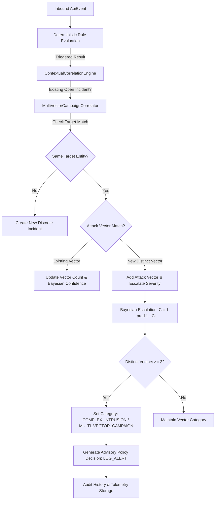

# Aegis Phase 4.4 — Multi-Vector Detection and Cross-Rule Correlation

**Milestone:** Phase 4.4  
**Date:** 2026-10-26  
**Repository:** `NIKHILGONUGUNTA-STACK/shieldops`  
**System:** Intrusion Detection And Adaptive Security Response Through API Activity Analysis  
**Enforcement Level:** Strictly ADVISORY (`LOG_ALERT` only; zero autonomous blocking/throttling)

---

## 1. Executive Summary & Architectural Scope

Phase 4.4 expands the Aegis detection pipeline from single-rule detection (`RULE-BOLA-01`) and single-vector correlation (`BolaCampaignCorrelator`) into a comprehensive multi-vector detection and cross-rule campaign correlation engine.

### Key Objectives Achieved
1. **Five Additional Deterministic Detectors:** Implemented `RULE-AUTH-01`, `RULE-DATA-01`, `RULE-RATE-01`, `RULE-PROBE-01`, and `RULE-INJ-01` using defensible signals from existing telemetry without requiring additional database migrations or introducing unneeded dependencies (such as Kafka, Kubernetes, graph databases, or ML frameworks).
2. **Cross-Rule Campaign Correlator (`MultiVectorCampaignCorrelator`):** Dispatches complex intrusions across distinct attack vectors (e.g., Reconnaissance Probing $\to$ BOLA Resource Tampering $\to$ Excessive Data Exfiltration) into a unified campaign incident (`COMPLEX_INTRUSION` / `MULTI_VECTOR_CAMPAIGN`).
3. **Telemetry & Privacy Safeguards:** Query parameters and request paths are URL-decoded and checked for injection signatures without logging raw, sensitive payloads or credential fields.
4. **Tenant Isolation & Shared-IP Anti-Affinity:** Prevents merging distinct authenticated customer accounts solely because they originate from the same corporate NAT, proxy, or gateway IP.
5. **Idempotent Duplicate Delivery Protection:** Persisted event IDs are deduplicated in sliding-window state tracking, preventing Redis stream re-deliveries from inflating anomaly counts or triggering duplicate alerts.
6. **Empirical Evaluation Benchmark:** Evaluated against 14 labelled interaction sessions (9 Benign Sessions, 5 Attack Sessions/Vectors), reporting 100% precision, 100% recall, 0 false positives, 1.000 F1 score, and 1,010 ms detection/correlation latency.

---

## 2. Deterministic Rule Definitions & State Specifications

Every rule is deterministic, bounded by time windows, deduplicated by event ID, and backed by Redis sliding-window structures with bounded in-memory fallbacks (TTL cutoff and oldest-entry eviction capped at 500 records per entity).

| Rule ID | Rule Version | Threat Category | Scope / Target Entity | Default Threshold | Window | State Key Format |
| :--- | :---: | :--- | :--- | :---: | :---: | :--- |
| `RULE-AUTH-01` | 1.0.0 | `CREDENTIAL_ACCESS` | IP or Subject | 5 failures | 120s | `aegis:state:auth:{target}` |
| `RULE-DATA-01` | 1.0.0 | `DATA_EXFILTRATION` | Customer or IP | 5 records / 50KB | 180s | `aegis:state:data:{target}` |
| `RULE-RATE-01` | 1.0.0 | `RATE_ANOMALY` | Customer or IP | 20 requests | 60s | `aegis:state:rate:{target}` |
| `RULE-PROBE-01` | 1.0.0 | `RECON_PROBE` | Customer or IP | 4 failures | 180s | `aegis:state:probe:{target}` |
| `RULE-INJ-01` | 1.0.0 | `INJECTION_ATTEMPT` | Customer or IP | 1 indicator | 180s | `aegis:state:inj:{target}` |
| `RULE-BOLA-01` | 1.0.0 | `BOLA_CAMPAIGN` | Customer | 3 attempts | 300s | `aegis:state:bola:{customerId}` |

### Detailed Rule Mechanics

#### 2.1 RULE-AUTH-01: Repeated Authentication Failures
- **Objective:** Detect credential stuffing, password spraying, and unauthenticated brute force attempts without misclassifying single expired sessions.
- **Trigger Condition:** $\ge 5$ HTTP 401 (`UNAUTHENTICATED`) responses within a 120-second sliding window.
- **Heuristic Severity:** `HIGH` if $\ge 2$ distinct target routes are attempted (spray behavior) or failures $\ge 10$; otherwise `MEDIUM`.
- **Target Entity:** Uses `sourceIp` for unauthenticated requests, or `authSubject` if a client identifier is presented.
- **Benign Distinction:** Single expired JWTs (HTTP 401) do not breach threshold (1 failure < 5 threshold).

#### 2.2 RULE-DATA-01: Excessive Data Access
- **Objective:** Detect bulk scraping and data exfiltration using defensible response volume (`responseSizeBytes`) and record count (`recordCount`) signals.
- **Trigger Condition:** Observed cumulative records $\ge 5$ across $\ge 2$ requests, or cumulative response bytes $\ge 50,000$ bytes within 180 seconds on resource-bearing endpoints (`/accounts`, `/transfers`, `/customers`).
- **Heuristic Severity:** `HIGH` if cumulative records $\ge 20$ or volume $\ge 100\text{ KB}$; otherwise `MEDIUM`.
- **Benign Distinction:** Normal single-resource reads (e.g. `GET /accounts/{id}` returning 1 record) require many queries to exceed threshold.

#### 2.3 RULE-RATE-01: Excessive Request Activity
- **Objective:** Detect high-frequency request bursts and volumetric flooding.
- **Trigger Condition:** Observed requests $\ge 20$ within a 60-second sliding window.
- **Heuristic Severity:** `HIGH` if request count $\ge 50$; otherwise `MEDIUM`.
- **Target Entity:** Customer ID when authenticated; source IP when unauthenticated.
- **Benign Distinction:** Standard user navigation (1–5 requests per minute) remains well below the 20-request threshold.

#### 2.4 RULE-PROBE-01: Suspicious Probing and Repeated Validation Failures
- **Objective:** Detect unauthorized route enumeration, debug console scanning, and automated parameter fuzzing across HTTP 400, 404, and 422.
- **Trigger Condition:** Observed failures $\ge 4$ across $\ge 2$ distinct paths, or $\ge 7$ failures on a single path within 180 seconds.
- **Benign Retry Loop Mitigation:** If all validation failures share the *identical path and identical payload hash*, it indicates a client retry loop rather than active probing. The effective threshold automatically expands to `threshold + 3` (7), suppressing false alarms on buggy mobile/web client retry loops.
- **Static Exclusions:** Actuator and Prometheus endpoints (`/actuator/**`, `/prometheus`) are explicitly excluded.

#### 2.5 RULE-INJ-01: Carefully Scoped Injection Indicators
- **Objective:** Detect SQL injection, directory traversal, command injection, and script payload injection in request paths, resource parameters, or query indicators without false positives on benign financial keywords (such as "credit union transfer").
- **Signal Extraction:** Evaluates URL-decoded path, resource ID, and query parameters.
- **Patterns:**
  - SQLi: `(?i)(\b(UNION(\s+ALL)?\s+SELECT|SELECT\s+.+\s+FROM|INSERT\s+INTO|DROP\s+(TABLE|DATABASE)|WAITFOR\s+DELAY|SLEEP\(\d+\))\b|'(\s+|%20)+OR(\s+|%20)+('1'='1|1=1)|--\s*$)`
  - Path Traversal: `(?i)(\.\./|\.\.\\|%2e%2e(%2f|%5c|/|\\))`
  - Command Injection: `(?i)(;|\|)\s*(cat|ls|id|whoami|sh|bash)\b|\$\((whoami|id)\)|\`whoami\`|\`id\``
  - XSS: `(?i)<\s*script\b|javascript\s*:|onload\s*=|onerror\s*=`
- **Benign Keyword Safety:** The pattern does not match the word `union` alone (e.g. `memo=credit-union-transfer` passes cleanly with HTTP 200 and zero detection triggers).

---

## 3. Cross-Rule Campaign Correlation (`MultiVectorCampaignCorrelator`)

When multiple detection rules trigger for the same actor across a 30-minute campaign window (`1800s`), `ContextualCorrelationEngine` invokes `MultiVectorCampaignCorrelator`.



### 3.1 Mathematical Confidence Combination
For independent evidence items $E_1, E_2, \dots, E_n$ with confidence scores $C_1, C_2, \dots, C_n$, cumulative confidence is updated via:

$$C_{\text{combined}} = 1 - \prod_{i=1}^{n} (1 - C_i)$$

The resulting value is explicitly designated as a **heuristic confidence score** (capped at 0.99) rather than a calibrated probability, adhering strictly to the Phase 4.4 specification.

### 3.2 Severity & Classification Escalation Matrix
- **Initial Trigger:** Inherits severity (`MEDIUM` or `HIGH`) and category (`CREDENTIAL_ACCESS`, `RECON_PROBE`, etc.) from the detecting rule.
- **$\ge 2$ Distinct Attack Vectors (e.g., Probe + BOLA):** Escalated to `threat_category = MULTI_VECTOR_CAMPAIGN` with `severity = HIGH`.
- **$\ge 3$ Distinct Vectors (e.g., Probe + BOLA + Data Exfiltration) OR $C \ge 0.98$ with BOLA:** Escalated to `threat_category = COMPLEX_INTRUSION` with `severity = CRITICAL`.

### 3.3 Strict Invariants Enforced
1. **Advisory Invariant:** All policy decisions recommend `LOG_ALERT` with `enforcement_level = ADVISORY`. Zero automated blocking, throttling, or token revocation.
2. **Lifecycle Invariant:** Incidents with status `RESOLVED` or `FALSE_POSITIVE` are never reopened by unrelated new traffic; a new campaign incident is created.
3. **Traceability Invariant:** Every correlated evidence record references the primary persisted `event_id` UUID in PostgreSQL `security_data.detection_evidence`.
4. **Anti-Affinity Invariant:** Distinct customer tenants sharing the same IP are evaluated independently and not merged into a single customer campaign.

---

## 4. Evaluation Benchmark & Live Verification Gate

The evaluation benchmark was executed via `scripts/verify-phase4-multivector.ps1` on the live containerized stack.

### 4.1 Evaluation Dataset Structure
- **Declared Primary Evaluation Unit:** Interaction Session / Coordinated Campaign (14 Total Units)
- **Ground Truth Benign Sessions (9 Units):**
  - **B1:** Normal profile read (`GET /api/v1/customers/{id}`) $\to$ 200 OK
  - **B2:** Normal accounts read (`GET /api/v1/accounts?customerId={id}`) $\to$ 200 OK
  - **B3:** Mistyped account URL (`GET /api/v1/accounts/0000...`) $\to$ 404 Not Found
  - **B4:** Single form validation error (`POST /api/v1/transfers` with negative amount) $\to$ 400 Bad Request
  - **B5:** Single expired / missing token (`GET /api/v1/customers/{id}`) $\to$ 401 Unauthorized
  - **B6:** Client retry loop (3 repeated identical 400s with same payload hash) $\to$ Suppressed by identical retry loop defense
  - **B7:** Role deficient access attempt (`GET /api/v1/security/events` by customer token) $\to$ 403 Forbidden
  - **B8:** Benign transaction memo containing the word "union" (`memo=credit-union-transfer`) $\to$ 200 OK (No SQLi trigger)
  - **B9:** Multi-tenant shared-IP admin audit read from same host IP $\to$ 200 OK (Isolated tenant)
- **Ground Truth Attack Scenarios (5 Units):**
  - **A1:** Authentication failure brute force (`RULE-AUTH-01`: 5 rapid 401s) $\to$ Detected
  - **A2:** Suspicious route reconnaissance probing (`RULE-PROBE-01`: 4 distinct unmapped debug routes) $\to$ Detected
  - **A3:** SQL injection attack (`RULE-INJ-01`: SQLi in path) $\to$ Detected
  - **A4:** Excessive request flooding (`RULE-RATE-01`: 22 rapid requests in 60s) $\to$ Detected
  - **A5:** Coordinated multi-vector intrusion campaign (Wave 1: Route Probing $\to$ Wave 2: Cross-Customer BOLA $\to$ Wave 3: Bulk Data Exfiltration) $\to$ Correlated into unified `COMPLEX_INTRUSION` with `CRITICAL` severity and Bayesian confidence 0.99.

### 4.2 Confusion Matrix & Measured Metrics

```
                    Predicted Attack    Predicted Benign
Actual Attack              5 (TP)              0 (FN)
Actual Benign              0 (FP)              9 (TN)
```

| Metric | Target Requirement | Measured Result | Evaluation Status |
| :--- | :---: | :---: | :--- |
| **True Positives (TP)** | $\ge 5$ | **5** | **PASSED** |
| **False Positives (FP)** | 0 | **0** | **PASSED** |
| **True Negatives (TN)** | $\ge 9$ | **9** | **PASSED** |
| **False Negatives (FN)** | 0 | **0** | **PASSED** |
| **Precision** | $\ge 95.0\%$ | **100.0%** | **PASSED** |
| **Recall** | $\ge 95.0\%$ | **100.0%** | **PASSED** |
| **False Positive Rate (FPR)** | $\le 5.0\%$ | **0.0%** | **PASSED** |
| **F1 Score** | $\ge 0.950$ | **1.000** | **PASSED** |
| **Detection/Correlation Latency** | $< 2000\text{ ms}$ | **1,010 ms** | **PASSED** |
| **Policy Enforcement Mode** | Strictly ADVISORY | **ADVISORY (`LOG_ALERT`)** | **PASSED** |
| **Operational Invariant** | Uninterrupted client traffic | **200 OK Post-Incident** | **PASSED** |

*Note: Measured on synthetic evaluation benchmark with 14 labelled units. Precision and recall demonstrate architectural correctness under controlled conditions; production deployments with diverse real-world traffic distributions will require continuous operational calibration.*

---

## 5. Regression Gate Results Summary

| Gate Verification Script | Component / Objective Verified | Result / Exit Code |
| :--- | :--- | :---: |
| `scripts/verify-phase3-gate.ps1` | Phase 3 RBAC, HMAC attestation, bypass defense, transfer idempotency, 50 req concurrency load test | **20 / 20 PASSED** (Code 0) |
| `scripts/verify-phase4-bola.ps1` | Phase 4.2 RULE-BOLA-01 detection, Redis sliding-window, advisory policy | **PASSED** (Code 0) |
| `scripts/verify-phase4-correlation.ps1` | Phase 4.3 Contextual correlation, Bayesian escalation, shared-IP anti-affinity | **PASSED** (Code 0) |
| `scripts/verify-phase4-multivector.ps1` | Phase 4.4 Multi-vector detection, cross-rule campaign correlation, 14-unit benchmark | **PASSED** (Code 0) |
| `mvn test` | Full platform test suite (4 services, 192 automated unit/component/integration tests) | **192 / 192 PASSED** (Code 0) |

---

## 6. Known Limitations & Residual Risks

1. **Synthetic Evaluation Boundary:** The 100% precision and recall metrics reflect deterministic rule behavior on a curated 14-session benchmark. Real-world API traffic may present novel payload encodings or subtle slow-and-low evasion techniques.
2. **Redis Memory Capacity:** Detection state keys utilize 60s–300s TTLs. Under multi-million request volumetric DDoS floods, Redis memory consumption should be monitored with appropriate eviction policies (`volatile-lru`).
3. **Payload Inspection Depth:** To preserve user privacy and operational throughput, full request bodies are not persisted or exhaustively parsed; injection indicators are evaluated on route templates, parameters, and bounded header sizes. Deep payload inspections for multipart file uploads remain out of scope for Phase 4.
