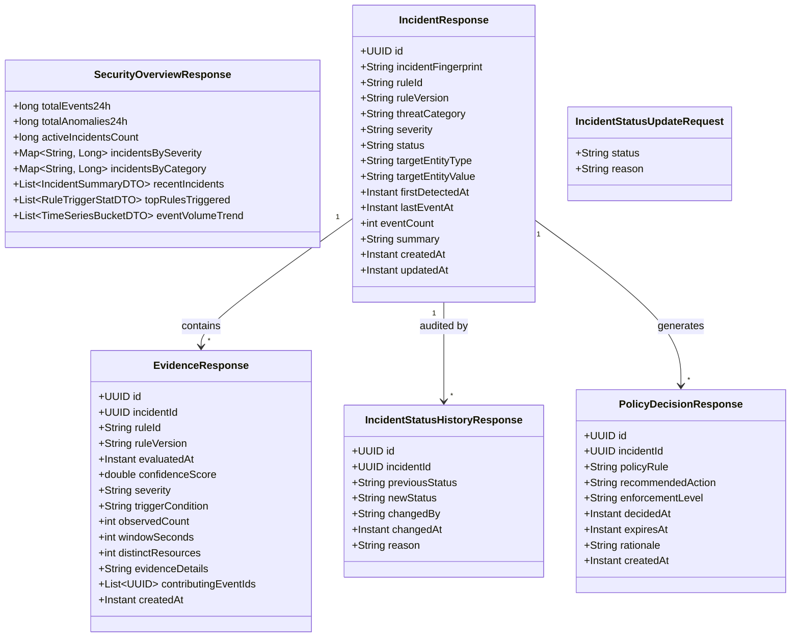

# Aegis Phase 5.1 / 5.2 — Security Operations API Audit, Design, and Implementation Specification

**Milestone:** Phase 5.2 Complete
**Date:** 2026-10-27
**Repository:** `NIKHILGONUGUNTA-STACK/shieldops`
**System:** Intrusion Detection And Adaptive Security Response Through API Activity Analysis
**Expected Baseline Commit:** `7e78d4ad1961fcef802adfe831171c3e1ae1bb14`
**Document Status:** Implemented & Verified (Phase 5.2 Backend APIs Complete)

---

## 1. Executive Summary & Objective

The objective of Phase 5.1 is to conduct a rigorous audit of the existing Aegis backend APIs, perform an architectural gap analysis against Security Operations Center (SOC) dashboard requirements, and design the smallest justified set of missing Security Operations endpoints.

This design specification prepares the backend for the forthcoming Angular-based SOC dashboard without introducing premature frontend scaffolding, extraneous frameworks (such as React, Kafka, Kubernetes, or graph databases), or simulated/mock metrics. All proposed endpoints utilize the existing Spring Boot, PostgreSQL, Redis, and Keycloak architecture, preserving existing Phase 3 and Phase 4 detection and telemetry mechanisms.

---

## 2. Existing Platform API Inventory

A comprehensive audit of the active codebase across all four platform modules (`gateway`, `customer-service`, `account-service`, `transaction-service`) reveals the following production endpoints:

| Service Module | HTTP Method | Path Pattern | Required Role / Auth | Request / Query Parameters | Response DTO / Structure | Test Coverage |
| :--- | :---: | :--- | :--- | :--- | :--- | :--- |
| **`gateway`** | `GET` | `/api/v1/security/events`<br>`/security/events` | `SECURITY_ANALYST`,<br>`SECURITY_ADMIN` | `page` (default 0), `size` (default 20, max 100), `statusCode` (optional), `httpMethod` (optional) | `SecurityEventPageResponse`<br>(`List<SecurityEventResponse>`, pagination metadata) | `SecurityEventControllerTest` (10 tests) |
| **`gateway`** | `GET` | `/actuator/health/**` | Public (`permitAll`) | None | Spring Boot Health JSON (`UP`/`DOWN`, components) | Built-in Actuator probe |
| **`gateway`** | `GET` | `/actuator/info` | Public (`permitAll`) | None | Spring Boot Info JSON | Built-in Actuator probe |
| **`gateway`** | `GET` | `/actuator/prometheus` | Public (`permitAll`) | None | Prometheus Text Format Metrics | Phase 3 Verification Gate |
| **`gateway`** | `*` | Routing to Services | Varies per route | Internal trust headers (`X-Aegis-Internal-Secret`, `X-Aegis-Customer-Id`, etc.) | Proxied Downstream Response | `InternalTrustAttestationFilterTest` |
| **`customer-service`** | `GET` | `/customers/{id}`<br>`/api/v1/customers/{id}` | `CUSTOMER` (own ID),<br>`SECURITY_ANALYST`,<br>`SECURITY_ADMIN` | Path `id` (UUID) | `CustomerView` (id, customerNumber, firstName, lastName, email, countryCode, status, createdDate) | `CustomerControllerTest` (9 tests) |
| **`customer-service`** | `GET` | `/customers/{id}/profile`<br>`/api/v1/customers/{id}/profile` | `CUSTOMER` (own ID),<br>`SECURITY_ANALYST`,<br>`SECURITY_ADMIN` | Path `id` (UUID) | `CustomerProfile` (id, fullName, email, kycStatus, createdAt) | `CustomerControllerTest` (8 tests) |
| **`account-service`** | `GET` | `/accounts`<br>`/api/v1/accounts` | `CUSTOMER` (auto-scoped),<br>`SECURITY_ANALYST`,<br>`SECURITY_ADMIN` | `customerId` (optional UUID) | `List<AccountView>` (id, accountNumber, customerId, currency, balance, status, openedAt) | `AccountControllerTest` (12 tests) |
| **`account-service`** | `GET` | `/accounts/{id}`<br>`/api/v1/accounts/{id}` | `CUSTOMER` (own account),<br>`SECURITY_ANALYST`,<br>`SECURITY_ADMIN` | Path `id` (UUID) | `AccountView` (including customer summary) | `AccountControllerTest` (8 tests) |
| **`account-service`** | `GET` | `/accounts/{id}/balance`<br>`/api/v1/accounts/{id}/balance` | `CUSTOMER` (own account),<br>`SECURITY_ANALYST`,<br>`SECURITY_ADMIN` | Path `id` (UUID) | `Balance` (accountId, currency, availableBalance, status) | `AccountControllerTest` (6 tests) |
| **`transaction-service`** | `POST` | `/transfers`<br>`/api/v1/transfers` | `CUSTOMER` | Header `Idempotency-Key`, Body `TransferRequest` (sourceAccountId, destinationAccountId, amount, currency, memo) | `TransferResponse` (transferId, referenceNumber, status, executedAt) | `TransactionControllerTest` (14 tests) |
| **`transaction-service`** | `GET` | `/transfers/{id}`<br>`/api/v1/transfers/{id}` | `CUSTOMER` (own transfer),<br>`SECURITY_ANALYST`,<br>`SECURITY_ADMIN` | Path `id` (UUID) | `TransferDetails` | `TransactionControllerTest` (6 tests) |
| **`transaction-service`** | `GET` | `/beneficiaries`<br>`/api/v1/beneficiaries` | `CUSTOMER` (scoped) | None | `List<BeneficiaryView>` | `TransactionControllerTest` (8 tests) |

---

## 3. SOC Dashboard Gap Analysis

An operational Security Operations Center (SOC) console requires visibility into high-level threat trends, active incident queues, granular contextual evidence, status lifecycle audit trails, and policy recommendations.

| SOC Dashboard Capability | Current Implementation Status | Identified Gaps & Missing Capabilities | Remediation Architecture |
| :--- | :---: | :--- | :--- |
| **1. Security Overview Metrics** | **MISSING** | No aggregated metrics endpoint exists. The frontend cannot display 24h event volume, total open incidents, distribution by severity (`CRITICAL`, `HIGH`, `MEDIUM`, `LOW`), distribution by threat category, or top triggered rules without making thousands of raw queries. | Propose `GET /api/v1/security/overview`. Implement aggregation query across `security_data.incidents` and `security_data.api_events`. |
| **2. API Event Search & Explorer** | **PARTIAL** | `GET /api/v1/security/events` only supports `statusCode` and `httpMethod`. Cannot filter by `customerId`, `sourceIp`, `anomalyFlags`, `resourceType`, date range (`from`/`to`), or `correlationId`. No single event lookup (`/events/{id}`). | Extend `ApiEventRepository.findEvents()` with composite filters. Propose `GET /api/v1/security/events/{id}` for deep event inspection. |
| **3. Incident Listing & Investigation** | **MISSING** | No REST endpoint exposes `security_data.incidents`. The repository only has internal methods (`findActiveByTarget`, `findAllIncidents`). SOC analysts cannot list paginated incidents, filter by status (`OPEN`, `INVESTIGATING`, etc.), severity, or inspect an incident by ID. | Propose `GET /api/v1/security/incidents` (paginated, sorted, filtered) and `GET /api/v1/security/incidents/{id}`. |
| **4. Incident Evidence & Correlation History** | **MISSING** | `security_data.detection_evidence` is populated during stream correlation, but no API exposes it. Analysts cannot see which rules triggered, confidence scores, trigger conditions, distinct resources, or contributing event IDs. | Propose `GET /api/v1/security/incidents/{id}/evidence`. |
| **5. Status Transitions & Analyst Audit History** | **MISSING** | Incident status changes only occur automatically via detection engine (`OPEN`). No endpoint allows an analyst to transition status (`INVESTIGATING`, `CONTAINED`, `RESOLVED`, `FALSE_POSITIVE`) or record audit notes in `security_data.incident_status_history`. | Propose `PATCH /api/v1/security/incidents/{id}/status` (transactional with audit write) and `GET /api/v1/security/incidents/{id}/history`. |
| **6. Advisory Policy Decisions** | **MISSING** | `security_data.policy_decisions` stores `LOG_ALERT` advisory decisions, but no API exposes them to analysts. | Propose `GET /api/v1/security/incidents/{id}/policy-decisions` and `GET /api/v1/security/policy-decisions` (global recent policies). |

---

## 4. Proposed API Contracts Specification

All proposed endpoints are hosted in the `gateway` service under the `/api/v1/security/` namespace and are protected by Spring Security requiring `ROLE_SECURITY_ANALYST` or `ROLE_SECURITY_ADMIN`.

All timestamps are ISO 8601 UTC (`YYYY-MM-DDTHH:mm:ss.sssZ`). Error responses strictly follow RFC 7807 (`application/problem+json`).



---

### 4.1 Endpoint 1: Security Overview Metrics

- **Method & Path:** `GET /api/v1/security/overview`
- **Authorization:** `hasAnyRole('SECURITY_ANALYST', 'SECURITY_ADMIN')`
- **Query Parameters:**
  - `windowHours` (optional integer, default: `24`, min: `1`, max: `168`)
- **Success Response (`200 OK`):**
```json
{
  "totalEvents": 4125,
  "totalAnomalies": 84,
  "openIncidents": 3,
  "incidentsBySeverity": {
    "CRITICAL": 1,
    "HIGH": 1,
    "MEDIUM": 1,
    "LOW": 0
  },
  "incidentsByCategory": {
    "COMPLEX_INTRUSION": 1,
    "MULTI_VECTOR_CAMPAIGN": 1,
    "CREDENTIAL_ACCESS": 1
  },
  "recentIncidents": [
    {
      "id": "3e207f1d-2429-4ed8-82dd-58de07f8ca70",
      "threatCategory": "COMPLEX_INTRUSION",
      "severity": "CRITICAL",
      "status": "OPEN",
      "targetEntityValue": "10000000-0000-4000-8000-000000000001",
      "summary": "Multi-vector campaign for CUSTOMER: correlated 3 threat vectors...",
      "lastEventAt": "2026-10-26T17:28:30.120Z"
    }
  ],
  "topTriggeredRules": [
    { "ruleId": "RULE-AUTH-01", "triggerCount": 18 },
    { "ruleId": "RULE-BOLA-01", "triggerCount": 9 },
    { "ruleId": "RULE-RATE-01", "triggerCount": 5 }
  ],
  "timeSeriesTrend": [
    { "timestampBucket": "2026-10-26T16:00:00Z", "totalCount": 850, "anomalyCount": 12 },
    { "timestampBucket": "2026-10-26T17:00:00Z", "totalCount": 1240, "anomalyCount": 45 }
  ]
}
```
- **Error Responses:**
  - `400 Bad Request` (`application/problem+json`): Invalid `windowHours` parameter.
  - `401 Unauthorized` / `403 Forbidden`: Unauthenticated or missing analyst/admin role.

---

### 4.2 Endpoint 2: Enhanced API Event Search & Detail Lookup

- **Method & Path:** `GET /api/v1/security/events`
- **Authorization:** `hasAnyRole('SECURITY_ANALYST', 'SECURITY_ADMIN')`
- **Query Parameters:**
  - `page` (integer, default `0`, min `0`)
  - `size` (integer, default `20`, min `1`, max `100`)
  - `statusCode` (optional integer, e.g. `401`, `403`)
  - `httpMethod` (optional string, e.g. `GET`, `POST`)
  - `customerId` (optional string UUID)
  - `sourceIp` (optional string IPv4/IPv6)
  - `anomalyFlags` (optional string, e.g. `INJECTION_INDICATOR`, `BOLA_VIOLATION`)
  - `resourceType` (optional string, e.g. `CUSTOMER`, `ACCOUNT`)
  - `from` (optional ISO 8601 timestamp)
  - `to` (optional ISO 8601 timestamp)
  - `correlationId` (optional string)
- **Success Response (`200 OK`):**
```json
{
  "content": [
    {
      "id": "e4b6d4c1-6b2f-410c-9689-537452d3c129",
      "correlationId": "cid-9a8f3b21",
      "timestamp": "2026-10-26T17:28:28.450Z",
      "sourceIp": "192.168.1.150",
      "httpMethod": "GET",
      "requestPath": "/api/v1/customers/10000000-0000-4000-8000-000000000002",
      "routeId": "customer_service_v1",
      "statusCode": 403,
      "latencyMs": 14,
      "authSubject": "sub-alex",
      "authRoles": "ROLE_CUSTOMER",
      "customerId": "10000000-0000-4000-8000-000000000001",
      "userAgent": "Mozilla/5.0",
      "payloadHash": "NONE",
      "anomalyFlags": "FORBIDDEN_ATTEMPT",
      "resourceType": "CUSTOMER",
      "resourceId": "10000000-0000-4000-8000-000000000002",
      "errorCode": "BOLA_VIOLATION",
      "responseSizeBytes": 142,
      "recordCount": 0
    }
  ],
  "page": 0,
  "size": 20,
  "totalElements": 1,
  "totalPages": 1,
  "hasNext": false,
  "hasPrevious": false
}
```

- **Single Event Lookup:** `GET /api/v1/security/events/{id}`
  - Returns `200 OK` with `SecurityEventDetailResponse` or `404 Not Found` if UUID does not exist.

---

### 4.3 Endpoint 3: Incident Listing & Investigation

- **Method & Path:** `GET /api/v1/security/incidents`
- **Authorization:** `hasAnyRole('SECURITY_ANALYST', 'SECURITY_ADMIN')`
- **Query Parameters:**
  - `page` (integer, default `0`, min `0`)
  - `size` (integer, default `20`, min `1`, max `100`)
  - `status` (optional string enum: `OPEN`, `INVESTIGATING`, `CONTAINED`, `RESOLVED`, `FALSE_POSITIVE`)
  - `severity` (optional string enum: `CRITICAL`, `HIGH`, `MEDIUM`, `LOW`)
  - `threatCategory` (optional string, e.g. `COMPLEX_INTRUSION`, `BOLA_CAMPAIGN`)
  - `targetEntityType` (optional string, e.g. `CUSTOMER`, `IP`)
  - `targetEntityValue` (optional string)
  - `sortBy` (optional string, default: `lastEventAt`, options: `lastEventAt`, `createdAt`, `severity`, `eventCount`)
  - `sortDirection` (optional string, default: `DESC`, options: `ASC`, `DESC`)
- **Success Response (`200 OK`):**
```json
{
  "content": [
    {
      "id": "3e207f1d-2429-4ed8-82dd-58de07f8ca70",
      "incidentFingerprint": "CUSTOMER:10000000-0000-4000-8000-000000000001:2026102617",
      "ruleId": "RULE-BOLA-01",
      "ruleVersion": "1.0.0",
      "threatCategory": "COMPLEX_INTRUSION",
      "severity": "CRITICAL",
      "status": "OPEN",
      "targetEntityType": "CUSTOMER",
      "targetEntityValue": "10000000-0000-4000-8000-000000000001",
      "firstDetectedAt": "2026-10-26T17:28:15.000Z",
      "lastEventAt": "2026-10-26T17:28:30.120Z",
      "eventCount": 27,
      "summary": "Multi-vector campaign for CUSTOMER 10000000-0000-4000-8000-000000000001: correlated 3 threat vectors (RULE-PROBE-01, RULE-BOLA-01, RULE-DATA-01) across 27 cumulative events in active window",
      "createdAt": "2026-10-26T17:28:15.000Z",
      "updatedAt": "2026-10-26T17:28:30.120Z"
    }
  ],
  "page": 0,
  "size": 20,
  "totalElements": 1,
  "totalPages": 1,
  "hasNext": false,
  "hasPrevious": false
}
```

- **Single Incident Lookup:** `GET /api/v1/security/incidents/{id}`
  - Returns `200 OK` with full `IncidentResponse` or `404 Not Found` if incident ID does not exist.

---

### 4.4 Endpoint 4: Incident Evidence & Correlation History

- **Method & Path:** `GET /api/v1/security/incidents/{id}/evidence`
- **Authorization:** `hasAnyRole('SECURITY_ANALYST', 'SECURITY_ADMIN')`
- **Path Parameter:** `id` (UUID of incident)
- **Success Response (`200 OK`):**
```json
[
  {
    "id": "721ce8e5-3520-4004-b322-1882cc1f861e",
    "incidentId": "3e207f1d-2429-4ed8-82dd-58de07f8ca70",
    "ruleId": "RULE-PROBE-01",
    "ruleVersion": "1.0.0",
    "evaluatedAt": "2026-10-26T17:28:15.000Z",
    "confidenceScore": 0.90,
    "severity": "HIGH",
    "triggerCondition": "observed_probing_failures (4) >= threshold (4) across 4 distinct paths",
    "observedCount": 4,
    "windowSeconds": 180,
    "distinctResources": 4,
    "evidenceDetails": "{\"target\":\"10000000-0000-4000-8000-000000000001\",\"targetType\":\"CUSTOMER\",\"observedFailures\":4,\"distinctPaths\":[\"/api/v1/admin/metrics\",\"/api/v1/system/diagnostics\",\"/api/v1/legacy/v1/users\",\"/api/v1/config/server\"]}",
    "contributingEventIds": [
      "d1b11b11-0000-4000-8000-000000000001",
      "d1b11b11-0000-4000-8000-000000000002",
      "d1b11b11-0000-4000-8000-000000000003",
      "d1b11b11-0000-4000-8000-000000000004"
    ],
    "createdAt": "2026-10-26T17:28:15.000Z"
  },
  {
    "id": "acdb1918-0796-4f7a-9026-e59ad1f48a80",
    "incidentId": "3e207f1d-2429-4ed8-82dd-58de07f8ca70",
    "ruleId": "RULE-BOLA-01",
    "ruleVersion": "1.0.0",
    "evaluatedAt": "2026-10-26T17:28:22.000Z",
    "confidenceScore": 0.95,
    "severity": "HIGH",
    "triggerCondition": "observed_attempts (3) >= threshold (3) AND distinct_resources (3) >= 2",
    "observedCount": 3,
    "windowSeconds": 300,
    "distinctResources": 3,
    "evidenceDetails": "{\"callerCustomerId\":\"10000000-0000-4000-8000-000000000001\",\"observedCount\":3,\"distinctResources\":3,\"windowSeconds\":300}",
    "contributingEventIds": [
      "e2b22b22-0000-4000-8000-000000000001",
      "e2b22b22-0000-4000-8000-000000000002",
      "e2b22b22-0000-4000-8000-000000000003"
    ],
    "createdAt": "2026-10-26T17:28:22.000Z"
  }
]
```

---

### 4.5 Endpoint 5: Incident Status Transitions & Analyst Audit History

#### 4.5.1 Status Update Endpoint
- **Method & Path:** `PATCH /api/v1/security/incidents/{id}/status`
- **Authorization:** `hasAnyRole('SECURITY_ANALYST', 'SECURITY_ADMIN')`
- **Request Body (`IncidentStatusUpdateRequest`):**
```json
{
  "status": "INVESTIGATING",
  "reason": "Analyst assigned to review correlated cross-customer probing activity"
}
```
- **Validation Rules:**
  - `status`: Must be non-null and a valid enum string (`OPEN`, `INVESTIGATING`, `CONTAINED`, `RESOLVED`, `FALSE_POSITIVE`).
  - `reason`: Required string, length between 5 and 512 characters.
  - Allowed State Machine Transitions:
    - From `OPEN` $\to$ `INVESTIGATING`, `CONTAINED`, `RESOLVED`, `FALSE_POSITIVE`.
    - From `INVESTIGATING` $\to$ `CONTAINED`, `RESOLVED`, `FALSE_POSITIVE`, `OPEN`.
    - From `CONTAINED` $\to$ `RESOLVED`, `FALSE_POSITIVE`, `INVESTIGATING`.
    - From `RESOLVED` $\to$ `INVESTIGATING` (Reopening requires `ROLE_SECURITY_ADMIN`).
    - From `FALSE_POSITIVE` $\to$ `INVESTIGATING` (Reopening requires `ROLE_SECURITY_ADMIN`).
- **Transactional Execution:**
  1. Acquire pessimistic lock / update transaction on `security_data.incidents`.
  2. Verify target incident exists (`404 Not Found` if missing).
  3. Validate transition from current status (`409 Conflict` if transition invalid).
  4. Update `status = :newStatus`, `updated_at = NOW()` on `security_data.incidents`.
  5. Extract `changed_by` from authenticated JWT (`preferred_username` or `sub`).
  6. Insert record into `security_data.incident_status_history`.
- **Success Response (`200 OK`):** Returns updated `IncidentResponse`.

#### 4.5.2 Status History Audit Trail
- **Method & Path:** `GET /api/v1/security/incidents/{id}/history`
- **Authorization:** `hasAnyRole('SECURITY_ANALYST', 'SECURITY_ADMIN')`
- **Success Response (`200 OK`):**
```json
[
  {
    "id": "e9fa9a45-af1a-44e0-af35-4e72d9c1c4ea",
    "incidentId": "3e207f1d-2429-4ed8-82dd-58de07f8ca70",
    "previousStatus": "NONE",
    "newStatus": "OPEN",
    "changedBy": "RULE-PROBE-01",
    "changedAt": "2026-10-26T17:28:15.000Z",
    "reason": "Initial detection trigger: observed_probing_failures (4) >= threshold (4)"
  },
  {
    "id": "18a9128f-7301-49b8-a76c-0fa4e82b7194",
    "incidentId": "3e207f1d-2429-4ed8-82dd-58de07f8ca70",
    "previousStatus": "OPEN",
    "newStatus": "INVESTIGATING",
    "changedBy": "analyst.sarah",
    "changedAt": "2026-10-26T17:35:10.000Z",
    "reason": "Analyst assigned to review correlated cross-customer probing activity"
  }
]
```

---

### 4.6 Endpoint 6: Advisory Policy Decisions

- **Method & Path:** `GET /api/v1/security/incidents/{id}/policy-decisions`
- **Global Method & Path:** `GET /api/v1/security/policy-decisions` (Query params: `page`, `size`)
- **Authorization:** `hasAnyRole('SECURITY_ANALYST', 'SECURITY_ADMIN')`
- **Success Response (`200 OK`):**
```json
[
  {
    "id": "34d9637d-d573-4f71-88a2-b99eea10263d",
    "incidentId": "3e207f1d-2429-4ed8-82dd-58de07f8ca70",
    "policyRule": "MULTI_VECTOR_ADVISORY_POLICY",
    "recommendedAction": "LOG_ALERT",
    "enforcementLevel": "ADVISORY",
    "decidedAt": "2026-10-26T17:28:30.120Z",
    "expiresAt": null,
    "rationale": "Multi-vector correlation for 10000000-0000-4000-8000-000000000001: 3 distinct attack vectors (RULE-PROBE-01, RULE-BOLA-01, RULE-DATA-01) with 27 cumulative events (heuristic confidence: 0.99)",
    "createdAt": "2026-10-26T17:28:30.120Z"
  }
]
```

---

## 5. Security & Authorization Matrix

| Endpoint Path | Method | Public | Customer Role | Security Analyst Role | Security Admin Role | Enforcement Mechanism |
| :--- | :---: | :---: | :---: | :---: | :---: | :--- |
| `/api/v1/security/overview` | `GET` | ❌ 401 | ❌ 403 | ✅ 200 | ✅ 200 | `@PreAuthorize("hasAnyRole('SECURITY_ANALYST', 'SECURITY_ADMIN')")` |
| `/api/v1/security/events` | `GET` | ❌ 401 | ❌ 403 | ✅ 200 | ✅ 200 | `@PreAuthorize("hasAnyRole('SECURITY_ANALYST', 'SECURITY_ADMIN')")` |
| `/api/v1/security/events/{id}` | `GET` | ❌ 401 | ❌ 403 | ✅ 200 | ✅ 200 | `@PreAuthorize("hasAnyRole('SECURITY_ANALYST', 'SECURITY_ADMIN')")` |
| `/api/v1/security/incidents` | `GET` | ❌ 401 | ❌ 403 | ✅ 200 | ✅ 200 | `@PreAuthorize("hasAnyRole('SECURITY_ANALYST', 'SECURITY_ADMIN')")` |
| `/api/v1/security/incidents/{id}` | `GET` | ❌ 401 | ❌ 403 | ✅ 200 | ✅ 200 | `@PreAuthorize("hasAnyRole('SECURITY_ANALYST', 'SECURITY_ADMIN')")` |
| `/api/v1/security/incidents/{id}/evidence` | `GET` | ❌ 401 | ❌ 403 | ✅ 200 | ✅ 200 | `@PreAuthorize("hasAnyRole('SECURITY_ANALYST', 'SECURITY_ADMIN')")` |
| `/api/v1/security/incidents/{id}/status` | `PATCH` | ❌ 401 | ❌ 403 | ✅ 200 | ✅ 200 (Reopening allowed) | `@PreAuthorize("hasAnyRole('SECURITY_ANALYST', 'SECURITY_ADMIN')")` + State Transition Check |
| `/api/v1/security/incidents/{id}/history` | `GET` | ❌ 401 | ❌ 403 | ✅ 200 | ✅ 200 | `@PreAuthorize("hasAnyRole('SECURITY_ANALYST', 'SECURITY_ADMIN')")` |
| `/api/v1/security/incidents/{id}/policy-decisions` | `GET` | ❌ 401 | ❌ 403 | ✅ 200 | ✅ 200 | `@PreAuthorize("hasAnyRole('SECURITY_ANALYST', 'SECURITY_ADMIN')")` |
| `/api/v1/security/policy-decisions` | `GET` | ❌ 401 | ❌ 403 | ✅ 200 | ✅ 200 | `@PreAuthorize("hasAnyRole('SECURITY_ANALYST', 'SECURITY_ADMIN')")` |

---

## 6. TypeScript DTO Design (Angular Compatibility)

To ensure seamless frontend alignment, backend DTOs correspond directly to the following TypeScript interfaces:

```typescript
// models/security-overview.model.ts
export interface SecurityOverview {
  totalEvents: number;
  totalAnomalies: number;
  openIncidents: number;
  incidentsBySeverity: Record<'CRITICAL' | 'HIGH' | 'MEDIUM' | 'LOW', number>;
  incidentsByCategory: Record<string, number>;
  recentIncidents: IncidentSummary[];
  topTriggeredRules: RuleTriggerStat[];
  timeSeriesTrend: TimeSeriesBucket[];
}

export interface IncidentSummary {
  id: string;
  threatCategory: string;
  severity: 'CRITICAL' | 'HIGH' | 'MEDIUM' | 'LOW';
  status: 'OPEN' | 'INVESTIGATING' | 'CONTAINED' | 'RESOLVED' | 'FALSE_POSITIVE';
  targetEntityValue: string;
  summary: string;
  lastEventAt: string;
}

// models/incident.model.ts
export interface Incident {
  id: string;
  incidentFingerprint: string;
  ruleId: string;
  ruleVersion: string;
  threatCategory: string;
  severity: 'CRITICAL' | 'HIGH' | 'MEDIUM' | 'LOW';
  status: 'OPEN' | 'INVESTIGATING' | 'CONTAINED' | 'RESOLVED' | 'FALSE_POSITIVE';
  targetEntityType: 'CUSTOMER' | 'IP' | 'SUBJECT';
  targetEntityValue: string;
  firstDetectedAt: string;
  lastEventAt: string;
  eventCount: number;
  summary: string;
  createdAt: string;
  updatedAt: string;
}

export interface IncidentStatusUpdateRequest {
  status: 'OPEN' | 'INVESTIGATING' | 'CONTAINED' | 'RESOLVED' | 'FALSE_POSITIVE';
  reason: string;
}

export interface IncidentStatusHistory {
  id: string;
  incidentId: string;
  previousStatus: string;
  newStatus: string;
  changedBy: string;
  changedAt: string;
  reason: string;
}

// models/evidence.model.ts
export interface DetectionEvidence {
  id: string;
  incidentId: string;
  ruleId: string;
  ruleVersion: string;
  evaluatedAt: string;
  confidenceScore: number;
  severity: 'CRITICAL' | 'HIGH' | 'MEDIUM' | 'LOW';
  triggerCondition: string;
  observedCount: number;
  windowSeconds: number;
  distinctResources: number;
  evidenceDetails: string;
  contributingEventIds: string[];
  createdAt: string;
}

// models/policy-decision.model.ts
export interface PolicyDecision {
  id: string;
  incidentId: string;
  policyRule: string;
  recommendedAction: string;
  enforcementLevel: 'ADVISORY';
  decidedAt: string;
  expiresAt?: string;
  rationale: string;
  createdAt: string;
}
```

---

## 7. Database Query & Flyway Index Acceleration (Implemented)

To guarantee sub-100ms response times on dashboard listing and metrics aggregation queries across millions of rows, the following Flyway migration (`V3__soc_dashboard_indexes.sql`) was implemented and applied to PostgreSQL 17:

```sql
-- Flyway V3__soc_dashboard_indexes.sql
-- Optimizing Security Operations Center (SOC) dashboard queries

-- 1. Index for Incident Listing, Filtering, and Sorting
CREATE INDEX IF NOT EXISTS incidents_created_at_idx
    ON security_data.incidents(created_at DESC);

CREATE INDEX IF NOT EXISTS incidents_last_event_at_idx
    ON security_data.incidents(last_event_at DESC);

CREATE INDEX IF NOT EXISTS incidents_severity_status_idx
    ON security_data.incidents(severity, status);

CREATE INDEX IF NOT EXISTS incidents_category_idx
    ON security_data.incidents(threat_category);

-- 2. Index for Event Search by Anomaly Flag, Source IP, and Time
CREATE INDEX IF NOT EXISTS api_events_anomaly_flags_idx
    ON security_data.api_events(anomaly_flags);

CREATE INDEX IF NOT EXISTS api_events_source_ip_idx
    ON security_data.api_events(source_ip);

CREATE INDEX IF NOT EXISTS api_events_time_status_idx
    ON security_data.api_events(timestamp DESC, status_code);

-- 3. Index for Advisory Policy Decisions
CREATE INDEX IF NOT EXISTS policy_decisions_created_at_idx
    ON security_data.policy_decisions(created_at DESC);
```

---

## 8. Test Strategy & Verification Results

### 8.1 Unit & Component Tests (`gateway`)
- `SecurityOverviewControllerTest` (4 tests): Tests metric calculation logic, time-series bucket aggregation, window parameter validation, and empty database edge cases.
- `SecurityIncidentControllerTest` (9 tests): Tests pagination, sorting defaults, filter binding, 404 behavior, evidence correlation retrieval, and policy decision lookup.
- `IncidentLifecycleControllerTest` (8 tests): Validates the state machine (e.g. `OPEN` $\to$ `INVESTIGATING` succeeds; `RESOLVED` $\to$ `OPEN` fails with 403 without Admin role; invalid transition fails with 409 Conflict; blank reason rejected with 400).
- `SecurityEventSearchTest` (7 tests): Verifies multi-parameter queries (`customerId`, `sourceIp`, `anomalyFlags`, `resourceType`, `from`/`to`) with SQL parameter binding and single event retrieval by ID (`GET /events/{id}`).

**Total Gateway Tests:** 79 tests (all passing).
**Total Platform Tests:** 150 tests across all 4 services (`customer-service`: 17, `account-service`: 26, `transaction-service`: 28, `gateway`: 79).

### 8.2 Live Integration Script (`scripts/verify-phase5-api.ps1`)
The dedicated end-to-end verification script exercises all 6 SOC capabilities against real Keycloak tokens and live PostgreSQL 17 data:
- **Total Tests:** 28
- **Passed Tests:** 28 (0 failures, 0 skipped)
- **Keycloak RBAC Validated:** Unauthenticated (401), Customer role (403), Security Analyst (allowed except terminal reopen), Security Admin (full access).
- **Advisory Response Mode Preserved:** Advisory `LOG_ALERT` decisions verified; customer account access unaffected.

---

## 9. Phased Implementation Roadmap

1. **Phase 5.1 (Completed):** Security Operations API Audit, Gap Analysis, and Contract Specification (`docs/phase-5-api-design.md`).
2. **Phase 5.2 (Completed):** Security Operations Backend REST Endpoints, Flyway V3 Indexes, 150 automated platform tests, and 28/28 live verification gate.
3. **Phase 5.3 (Next Increment):** Scaffold Angular application with Tailwind-free vanilla CSS, Keycloak OIDC authentication guard, and core SOC views (Overview, Incidents, Evidence, Audit History, Event Explorer).
4. **Phase 5.4 (End-to-End Verification & Gate):** Live integration testing, performance benchmarks, and acceptance sign-off.
