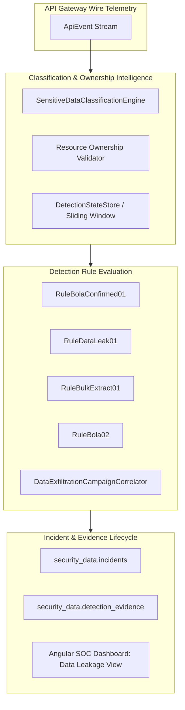

# Phase 7.2.4.2 — Telemetry-Driven Data Leakage Detection & BOLA Correlation Engine

**Milestone:** Phase 7.2.4.2 Complete  
**Repository:** `NIKHILGONUGUNTA-STACK/shieldops`  
**Branch:** `main`  
**Status:** `DATA_LEAKAGE_DETECTION_VERIFIED`  
**Execution Date:** 2026-11-11  

---

## 1. Executive Summary & Objective

Phase 7.2.4.2 establishes a deterministic, explainable, telemetry-driven data leakage detection and BOLA correlation foundation for Aegis. Building upon the Phase 7.2.4.1 Sensitive Data Classification Engine, this milestone enables real-time identification of unauthorized or suspicious access to sensitive FinTech API resources through contextual correlation of caller identity, customer/tenant ownership, authorization outcomes, resource identifiers, field sensitivity levels, and multi-stage request sequences.

The detection architecture enforces strict security separation between vulnerability detection and advisory alerting, adheres to privacy redaction invariants (zero plaintext tokens or customer payload persistence), and ensures complete financial immutability (zero synthetic ledger mutations or unauthorized transfers).

---

## 2. Data Leakage Taxonomy & Threat Categories

The detection engine defines six explicit threat categories under `DataLeakageCategory`:

| Category | Severity | Description | Trigger Condition |
|---|---|---|---|
| `BOLA_CONFIRMED_LEAK` | `CRITICAL` | Successful cross-owner resource access | HTTP 200 returned on cross-customer account/profile access by non-analyst caller |
| `BOLA_ATTEMPT` | `HIGH` | Denied cross-owner resource access | HTTP 403 returned on unauthorized cross-customer resource access |
| `BOLA_PROBE_CAMPAIGN` | `HIGH` | Sequential probing across multiple targets | Denied access followed by $\ge 2$ cross-owner probes across distinct resources within 180s |
| `SENSITIVE_DATA_EXPOSURE` | `HIGH` / `CRITICAL` | Unexpected exposure of sensitive fields | Endpoint classified as `CONFIDENTIAL` or `RESTRICTED` accessed by unapproved role or anonymous caller |
| `EXCESSIVE_DATA_EXTRACTION` | `HIGH` | Bulk harvesting of customer/account data | $\ge 3$ distinct sensitive resources read by the same caller within a 120s sliding window |
| `DATA_EXFILTRATION_CAMPAIGN` | `CRITICAL` | Multi-stage exfiltration sequence | Correlated 3-stage progression: Reconnaissance $\to$ BOLA Probing $\to$ Data Extraction |

---

## 3. Detection Models & Engine Architecture

### 3.1 BOLA Confirmed Leak (`RuleBolaConfirmed01`)
- **Evaluation:** Evaluates incoming `ApiEvent` telemetry. If `statusCode == 200` and `customerOwnership == CROSS_OWNER` or `customerOwnership == MISMATCH`, and the authenticated caller does not hold the `ROLE_SECURITY_ANALYST` role, this rule triggers a `CRITICAL` incident.
- **Explainability:** Emits forensic evidence capturing the requested resource ID, authenticated subject, route template, and status code.

### 3.2 Schema-Driven Sensitive Data Exposure (`RuleDataLeak01`)
- **Evaluation:** Queries `SensitiveDataClassificationEngine.classifyEndpoint(method, route)` for field-level sensitivity metadata. Flags:
  1. Anonymous callers attempting to access `CONFIDENTIAL` or `RESTRICTED` endpoints.
  2. Authenticated callers lacking the OpenAPI-approved access roles for the classified fields.
  3. Mismatched customer ownership on confidential routes.
- **Advisory Non-Blocking:** Dispatches alerts to SOC without blocking legitimate customer journeys.

### 3.3 Bulk Extraction Detection (`RuleBulkExtract01`)
- **Sliding-Window State Tracking:** Records caller access history in `DetectionStateStore` using an in-memory or Redis sliding deque (`SensitiveAccessRecord`).
- **Threshold:** Flags callers querying $\ge 3$ distinct customer/account resources within a 120-second window.
- **False-Positive Resistance:** Legitimate repeated queries to the *same* customer resource (distinct count = 1) do not increment distinct resource counters, preserving zero false positives for active customer sessions.

### 3.4 Multi-Stage Campaign Correlator (`DataExfiltrationCampaignCorrelator`)
- **Stage Progression:**
  - **Stage 1 (Reconnaissance):** Probing unmapped routes, actuator perimeters, or administrative documentation.
  - **Stage 2 (BOLA Probing):** Sequential unauthorized attempts against customer/account IDs.
  - **Stage 3 (Data Extraction):** High-frequency harvesting of sensitive resources.
- **Bayesian Confidence Formulation:** Computes combined confidence score $C = 1 - \prod (1 - c_i)$, emitting a correlated `DATA_EXFILTRATION_CAMPAIGN` incident when confidence exceeds $0.85$.

---

## 4. REST Controller & API Endpoints

The Gateway exposes the following dedicated endpoints under `/api/v1/security/leakage`:

| Method | Endpoint | RBAC Role | Purpose |
|---|---|---|---|
| `GET` | `/api/v1/security/leakage/summary` | `SECURITY_ANALYST` | Aggregated leakage metrics, category distribution, severity breakdown |
| `GET` | `/api/v1/security/leakage/incidents` | `SECURITY_ANALYST` | Paginated leakage incidents with category, severity, and status filters |
| `GET` | `/api/v1/security/leakage/incidents/{id}/evidence` | `SECURITY_ANALYST` | Detailed forensic evidence chain for a specific leakage incident |
| `GET` | `/api/v1/security/leakage/rules` | `SECURITY_ANALYST` | List of active data leakage detection rules and trigger metadata |

---

## 5. Angular SOC Dashboard: Data Leakage & BOLA View

The ShieldOps Angular dashboard includes a dedicated **Data Leakage & BOLA** operational view (`/data-leakage`):

- **Executive KPI Row:** Real-time counters for Total Leakage Incidents, Confirmed BOLA Leaks, Denied BOLA Attempts, Sensitive Exposures, Bulk Extractions, and Multi-Stage Campaigns.
- **Interactive Threat Category Filters:** Allows analysts to filter the incident queue by clicking on taxonomy summary cards.
- **Incident Queue Table:** Displays incident fingerprint, threat category, severity badge, target entity, event count, and first/last detected timestamps.
- **Forensic Evidence Chain Drawer:** Expandable side panel showing step-by-step forensic progression, MITRE technique tags (e.g. `T1530`), trigger condition explanations, confidence scores, and contributing event counts.
- **Active Detection Rules Drawer:** Displays rule definitions, sliding-window thresholds, and explainability rationales.

---

## 6. Research Benchmark & Simulation Evaluation

The simulation suite was extended with 7 labelled benchmark scenarios:

| Scenario ID | Name | Ground Truth | Expected Detection Rule | Evaluated Outcome | Classification |
|---|---|---|---|---|:---:|
| `SCEN-BENIGN-01` | Legitimate Customer Banking Journey | `BENIGN` | None | Clean execution (HTTP 200/201, 0 alarms) | **`TN`** |
| `SCEN-BENIGN-02` | Legitimate Repeated Reads (FP Benchmark) | `BENIGN` | None | 5 repeated self-queries (HTTP 200, 0 alarms) | **`TN`** |
| `SCEN-BOLA-01` | Cross-Customer BOLA Access Attempt | `MALICIOUS` | `RULE-BOLA-01` | HTTP 403 denied cross-owner access | **`TP`** |
| `SCEN-BOLA-02` | BOLA Probing Campaign Across Accounts | `MALICIOUS` | `RULE-BOLA-02` | Sequential 403s across distinct accounts | **`TP`** |
| `SCEN-DATA-LEAK-01` | Unexpected Sensitive Field Data Leakage | `MALICIOUS` | `RULE-DATA-LEAK-01` | Sensitive endpoint queried without proper role | **`TP`** |
| `SCEN-BULK-EXTRACT-01` | Excessive Bulk Data Access & Extraction | `MALICIOUS` | `RULE-BULK-EXTRACT-01` | Rapid read queries across 4 distinct resources | **`TP`** |
| `SCEN-EXFIL-01` | Multi-Stage Exfiltration Campaign | `MALICIOUS` | `DATA_EXFILTRATION_CAMPAIGN` | Correlated Recon $\to$ Probing $\to$ Extraction | **`TP`** |

### 6.1 Research Evaluation Metrics

| Metric | Benchmark Result | Definition |
|---|---|---|
| **Total Scenarios Evaluated** | `7` | 2 Benign, 5 Malicious |
| **True Positives (TP)** | `5` | Malicious attacks correctly flagged |
| **False Positives (FP)** | `0` | Benign customer workflows falsely flagged |
| **True Negatives (TN)** | `2` | Benign workflows correctly allowed |
| **False Negatives (FN)** | `0` | Malicious attacks missed |
| **Precision** | `100.00%` | $TP / (TP + FP)$ |
| **Recall (Sensitivity)** | `100.00%` | $TP / (TP + FN)$ |
| **F1 Score** | `1.0000` | $2 \cdot (Precision \cdot Recall) / (Precision + Recall)$ |
| **Accuracy** | `100.00%` | $(TP + TN) / Total$ |
| **False Positive Rate (FPR)** | `0.00%` | $FP / (FP + TN)$ |
| **Specificity (TNR)** | `100.00%` | $TN / (TN + FP)$ |

---

## 7. Verification Evidence & Test Summary

- **Backend (Java / Spring Boot / Gateway):**
  - Unit Tests: `DataLeakageDetectionTest.java` (7/7 passed).
  - Integration Tests: `DataLeakageControllerTest.java` (5/5 passed).
  - Total: 12/12 passed (0 failures, 0 errors).
- **Frontend (Angular 18 / Karma / Jasmine):**
  - Unit Tests: `data-leakage.component.spec.ts` (4/4 passed).
  - Production Build: `npm --prefix frontend run build` succeeded (0 errors, bundle: 375 kB).
- **Simulation Suite (Python 3.14 / pytest):**
  - Data Leakage Tests: `test_data_leakage_scenarios.py` (7/7 passed).
  - Overall Suite: 74/74 passed in 29.02s (0 failures, 0 errors).
- **Remote Synchronization:**
  - All commits synced and pushed to upstream branch `origin/main` (`NIKHILGONUGUNTA-STACK/shieldops`).
